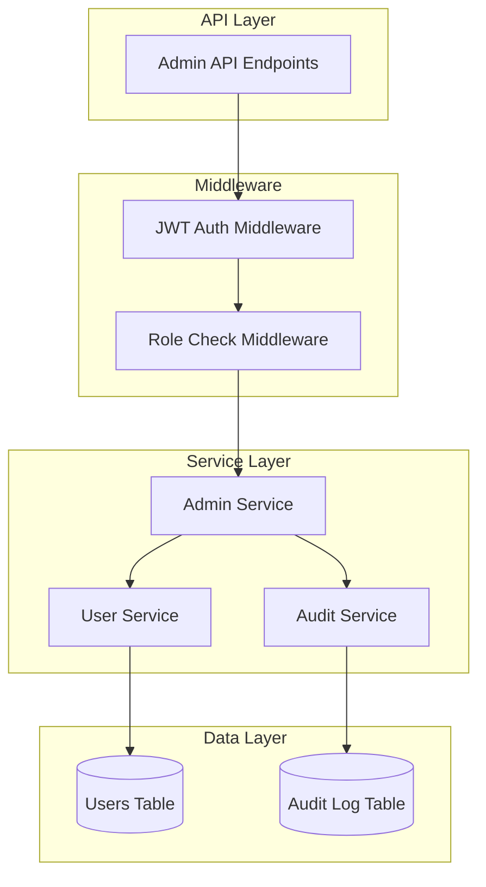

# Admin System Design Document

## Overview

The Admin System provides administrative capabilities for the AI-Native IM application, enabling authorized users to manage accounts, monitor system health, and enforce platform policies. The system implements role-based access control (RBAC) with three privilege levels and comprehensive audit logging.

## Architecture



## Components and Interfaces

### 1. User Role Enum

```rust
#[derive(Debug, Clone, Serialize, Deserialize, sqlx::Type, PartialEq)]
#[sqlx(type_name = "varchar", rename_all = "lowercase")]
pub enum UserRole {
    User,
    Moderator,
    Admin,
}
```

### 2. Admin Service Interface

```rust
pub trait AdminServiceTrait {
    // Permission checking
    async fn check_admin_permission(&self, user_id: &Uuid) -> Result<UserRole, AdminError>;
    
    // User management
    async fn suspend_user(&self, admin_id: &Uuid, request: UserManagementRequest) -> Result<(), AdminError>;
    async fn activate_user(&self, admin_id: &Uuid, request: UserManagementRequest) -> Result<(), AdminError>;
    async fn delete_user(&self, admin_id: &Uuid, request: UserManagementRequest) -> Result<(), AdminError>;
    async fn change_user_role(&self, admin_id: &Uuid, request: RoleChangeRequest) -> Result<(), AdminError>;
    
    // Queries
    async fn get_stats(&self, admin_id: &Uuid) -> Result<AdminStats, AdminError>;
    async fn list_users(&self, admin_id: &Uuid, page: i32, per_page: i32) -> Result<UserListResponse, AdminError>;
    async fn search_users(&self, admin_id: &Uuid, query: UserSearchQuery) -> Result<UserListResponse, AdminError>;
}
```

### 3. Admin API Endpoints

| Method | Endpoint | Description | Required Role |
|--------|----------|-------------|---------------|
| GET | /admin/stats | Get system statistics | Moderator+ |
| GET | /admin/users | List users with pagination | Moderator+ |
| GET | /admin/users/search | Search users | Moderator+ |
| POST | /admin/users/:id/suspend | Suspend user account | Moderator+ |
| POST | /admin/users/:id/activate | Activate user account | Moderator+ |
| DELETE | /admin/users/:id | Soft delete user | Admin |
| PUT | /admin/users/:id/role | Change user role | Admin |
| GET | /admin/audit-logs | View audit logs | Admin |

## Data Models

### UserRole Addition to User Model

```rust
pub struct User {
    pub id: Uuid,
    pub username: String,
    pub email: String,
    pub password_hash: String,
    pub avatar_url: Option<String>,
    pub bio: Option<String>,
    pub online_status: OnlineStatus,
    pub last_seen_at: Option<DateTime<Utc>>,
    pub account_status: AccountStatus,
    pub role: UserRole,  // New field
    pub created_at: DateTime<Utc>,
    pub updated_at: DateTime<Utc>,
}
```

### Admin Request/Response Types

```rust
pub struct UserManagementRequest {
    pub user_id: Uuid,
    pub reason: Option<String>,
}

pub struct RoleChangeRequest {
    pub user_id: Uuid,
    pub new_role: UserRole,
    pub reason: Option<String>,
}

pub struct AdminStats {
    pub total_users: i64,
    pub active_users: i64,
    pub suspended_users: i64,
    pub deleted_users: i64,
    pub online_users: i64,
    pub users_by_role: HashMap<String, i64>,
}

pub struct UserListResponse {
    pub users: Vec<UserAdminView>,
    pub total: i64,
    pub page: i32,
    pub per_page: i32,
}

pub struct UserAdminView {
    pub id: Uuid,
    pub username: String,
    pub email: String,
    pub role: UserRole,
    pub account_status: AccountStatus,
    pub online_status: OnlineStatus,
    pub last_seen_at: Option<DateTime<Utc>>,
    pub created_at: DateTime<Utc>,
}
```

## Correctness Properties

*A property is a characteristic or behavior that should hold true across all valid executions of a system-essentially, a formal statement about what the system should do. Properties serve as the bridge between human-readable specifications and machine-verifiable correctness guarantees.*

### Property 1: Default Role Assignment
*For any* newly created user, the assigned role SHALL be "User".
**Validates: Requirements 1.1**

### Property 2: Role-Based Access Control
*For any* user with role R and any admin endpoint E, access SHALL be granted if and only if R has sufficient privileges for E (Admin > Moderator > User).
**Validates: Requirements 1.3, 1.4, 1.5**

### Property 3: Suspension State Transition
*For any* active user account, after suspension the account_status SHALL be "Suspended" AND login attempts SHALL fail.
**Validates: Requirements 2.1**

### Property 4: Activation State Transition
*For any* suspended user account, after activation the account_status SHALL be "Active" AND login attempts SHALL succeed.
**Validates: Requirements 2.2**

### Property 5: Soft Delete Preservation
*For any* deleted user account, the database record SHALL still exist with account_status "Deleted".
**Validates: Requirements 2.3**

### Property 6: Audit Log Completeness
*For any* administrative action, an audit log entry SHALL exist containing admin_id, action_type, target_id, timestamp, and reason (if provided).
**Validates: Requirements 2.4, 5.1, 5.3**

### Property 7: Privilege Hierarchy Enforcement
*For any* admin action targeting another admin, the action SHALL succeed only if the requesting user has strictly higher privileges.
**Validates: Requirements 2.5**

### Property 8: Pagination Correctness
*For any* paginated request with page P and page_size S, the response SHALL contain at most S items and the correct offset.
**Validates: Requirements 3.2**

### Property 9: Search Filter Accuracy
*For any* search query with filters, all returned users SHALL match all specified filter criteria.
**Validates: Requirements 3.3**

### Property 10: User Details Completeness
*For any* user in admin responses, the record SHALL include id, username, email, role, account_status, created_at, and last_seen_at.
**Validates: Requirements 3.1, 3.4**

### Property 11: Statistics Completeness
*For any* statistics response, the record SHALL include total_users, active_users, suspended_users, deleted_users, online_users, and users_by_role counts.
**Validates: Requirements 4.1, 4.2**

## Error Handling

```rust
#[derive(Debug, Error)]
pub enum AdminError {
    #[error("User not found")]
    UserNotFound,
    
    #[error("Permission denied: {0}")]
    PermissionDenied(String),
    
    #[error("Invalid operation: {0}")]
    InvalidOperation(String),
    
    #[error("Cannot modify user with higher privileges")]
    InsufficientPrivileges,
    
    #[error("Database error: {0}")]
    DatabaseError(#[from] sqlx::Error),
}
```

### HTTP Status Code Mapping

| Error | HTTP Status |
|-------|-------------|
| UserNotFound | 404 Not Found |
| PermissionDenied | 403 Forbidden |
| InvalidOperation | 400 Bad Request |
| InsufficientPrivileges | 403 Forbidden |
| DatabaseError | 500 Internal Server Error |

## Testing Strategy

### Property-Based Testing Library
- **Library**: `proptest` (Rust)
- **Minimum iterations**: 100 per property test

### Unit Tests
- Test individual service methods with specific inputs
- Test error conditions and edge cases
- Test role permission checks

### Property-Based Tests
Each correctness property will be implemented as a property-based test:

1. **Property 1 Test**: Generate random user creation data, verify role is always "User"
2. **Property 2 Test**: Generate random (user_role, endpoint) pairs, verify access control
3. **Property 3 Test**: Generate random active users, suspend them, verify state and login failure
4. **Property 4 Test**: Generate random suspended users, activate them, verify state and login success
5. **Property 5 Test**: Generate random users, delete them, verify record exists with "Deleted" status
6. **Property 6 Test**: Generate random admin actions, verify audit log entries exist with all fields
7. **Property 7 Test**: Generate random (admin, target_admin) pairs, verify privilege hierarchy
8. **Property 8 Test**: Generate random pagination parameters, verify response size and offset
9. **Property 9 Test**: Generate random search filters, verify all results match criteria
10. **Property 10 Test**: Generate random user list requests, verify all required fields present
11. **Property 11 Test**: Generate statistics requests, verify all required counts present

### Test Annotations
Each property-based test MUST include a comment in this format:
```rust
// **Feature: admin-system, Property 1: Default Role Assignment**
```

### Integration Tests
- Test complete admin workflows (suspend → activate → delete)
- Test audit log creation across multiple actions
- Test role change cascading effects
