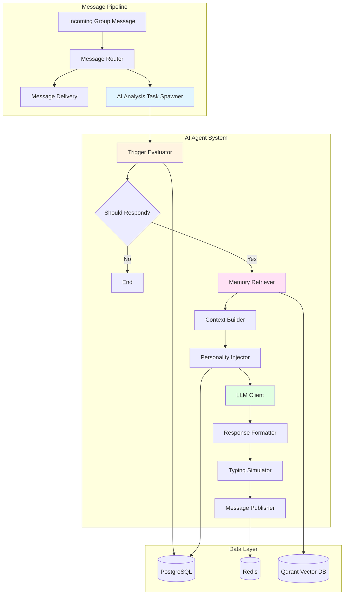

# Design Document: AI Agent System

## Overview

The AI Agent System is the core differentiating feature of this minimalist IM application. It transforms traditional chatbot interactions into a "real group member" experience through advanced RAG (Retrieval-Augmented Generation), personality customization, intelligent triggering, and human-like behavior simulation.

The system is designed as a modular, asynchronous pipeline that processes group chat messages, evaluates whether the AI should respond, retrieves relevant historical context, applies personality traits, generates responses via LLM APIs, and delivers messages with realistic typing delays.

Key design principles:
- **Non-intrusive**: AI doesn't respond to every message, maintaining natural conversation flow
- **Context-aware**: Leverages vector database for semantic memory retrieval
- **Personality-driven**: Highly customizable character traits and speech patterns
- **Performance-first**: Asynchronous processing ensures zero impact on message delivery
- **Modular**: Clear separation of concerns for maintainability and extensibility

## Architecture

### High-Level Architecture



### Component Interaction Flow

1. **Message Ingestion**: Group messages enter the WebSocket handler
2. **Dual Path**: Message is immediately delivered to recipients while spawning async AI analysis
3. **Trigger Evaluation**: Multi-factor decision on whether AI should respond
4. **Memory Retrieval**: Semantic search in vector database for relevant history
5. **Context Assembly**: Combine recent messages + retrieved memories + personality config
6. **LLM Generation**: Call external API with enriched context
7. **Typing Simulation**: Delay response with "typing" indicator
8. **Message Broadcast**: Publish AI response through Redis Pub/Sub

## Components and Interfaces

### 1. Trigger Evaluator

**Responsibility**: Determine if AI Agent should respond to a message

**Interface**:
```rust
#[async_trait]
pub trait TriggerEvaluator {
    async fn evaluate(&self, message: &ChatMessage, context: &GroupContext) -> TriggerDecision;
}

pub struct TriggerDecision {
    pub should_respond: bool,
    pub probability: f32,
    pub trigger_type: TriggerType,
}

pub enum TriggerType {
    Mention,           // @Bot - 100%
    Keyword,           // Regex match - 60-80%
    ContextSimilarity, // Vector similarity > 0.8 - 40-60%
    Random,            // Random interjection - 1-5%
    SilenceBreaker,    // 2hr+ silence - 10-20%
}
```

**Implementation Strategy**:
- Check for explicit @mentions first (fast path)
- Run keyword regex patterns in parallel
- Query vector DB for semantic similarity (async)
- Apply time-based silence detection
- Combine factors with weighted probability
- Use random number generation for final decision

### 2. Memory Retriever (RAG Component)

**Responsibility**: Fetch semantically relevant historical messages

**Interface**:
```rust
#[async_trait]
pub trait MemoryRetriever {
    async fn retrieve_context(
        &self,
        query: &str,
        group_id: &str,
        limit: usize,
    ) -> Result<Vec<HistoricalMessage>>;
}

pub struct HistoricalMessage {
    pub content: String,
    pub sender_id: String,
    pub timestamp: i64,
    pub similarity_score: f32,
    pub time_decay_weight: f32,
}
```

**Implementation Strategy**:
- Generate embedding for current message using same model as storage
- Query Qdrant with cosine similarity
- Retrieve top 10 results
- Apply time-decay formula: `weight = 0.5 + 0.5 * exp(-days/30)`
- Filter out messages with final score < 0.3
- Return sorted by weighted score

**Vector Database Schema**:
```rust
// Qdrant collection structure
{
    "collection_name": "chat_memories",
    "vectors": {
        "size": 1536,  // OpenAI ada-002 dimension (or 1024 for BGE)
        "distance": "Cosine"
    },
    "payload": {
        "message_id": "string",
        "group_id": "string",
        "sender_id": "string",
        "content": "string",
        "timestamp": "integer",
        "message_type": "string"
    }
}
```

### 2.1 Embedding Service

**Responsibility**: Generate text embeddings for semantic search

**Interface**:
```rust
#[async_trait]
pub trait EmbeddingService: Send + Sync {
    async fn embed(&self, text: &str) -> Result<Vec<f32>, AIAgentError>;
    async fn embed_batch(&self, texts: &[String]) -> Result<Vec<Vec<f32>>, AIAgentError>;
}
```

**Supported Providers** ✅:

| Provider | Model | Dimension | Best For |
|----------|-------|-----------|----------|
| OpenAI | text-embedding-3-small | 1536 | General purpose |
| OpenAI | text-embedding-ada-002 | 1536 | Legacy |
| SiliconFlow | BAAI/bge-large-zh-v1.5 | 1024 | Chinese text |
| SiliconFlow | BAAI/bge-m3 | 1024 | Multilingual |
| SiliconFlow | BAAI/bge-large-en-v1.5 | 1024 | English text |

**Factory Pattern**:
```rust
// Auto-detect from environment
// Priority: OpenAI > SiliconFlow > Mock
if config.openai_api_key.is_some() {
    OpenAIEmbedding::new(api_key, model)
} else if config.siliconflow_api_key.is_some() {
    SiliconFlowEmbedding::new(api_key, model)
} else {
    MockEmbeddingService::default()
}
```

### 2.2 Vision Model

**Responsibility**: Analyze images and provide descriptions

**Interface**:
```rust
#[async_trait]
pub trait VisionModel: Send + Sync {
    async fn analyze_image(&self, image_url: &str, prompt: Option<&str>) -> Result<String, AIAgentError>;
    async fn analyze_image_base64(&self, base64_data: &str, mime_type: &str, prompt: Option<&str>) -> Result<String, AIAgentError>;
}
```

**Supported Providers** ✅:

| Provider | Model | Features |
|----------|-------|----------|
| OpenAI | GPT-4-Vision | High accuracy, English |
| SiliconFlow | Qwen/Qwen2-VL-7B-Instruct | Chinese + English |
| SiliconFlow | OpenGVLab/InternVL2-8B | Multilingual |

**Factory Pattern**:
```rust
// Auto-detect from environment
// Priority: OpenAI > SiliconFlow > Mock
if config.openai_api_key.is_some() && config.enable_vision {
    OpenAIVision::new(api_key, model)
} else if config.siliconflow_api_key.is_some() && config.enable_vision {
    SiliconFlowVision::new(api_key, model)
} else {
    MockVisionModel::default()
}
```

### 3. Personality System

**Responsibility**: Manage AI character traits and inject them into prompts

**Interface**:
```rust
pub trait PersonalityManager {
    fn get_system_prompt(&self, agent_id: &str) -> Result<String>;
    fn update_personality(&self, agent_id: &str, config: PersonalityConfig) -> Result<()>;
}

pub struct PersonalityConfig {
    pub toxicity_level: u8,      // 0-10
    pub enthusiasm_level: u8,    // 0-10
    pub expertise_domain: Vec<String>,
    pub speech_suffix: Option<String>,  // e.g., "喵", "~"
    pub user_affinity: HashMap<String, i8>,  // user_id -> affinity score
}
```

**System Prompt Template**:
```rust
const PROMPT_TEMPLATE: &str = r#"
You are {agent_name}, a member of this group chat with the following personality:

Personality Traits:
- Toxicity: {toxicity}/10 (0=polite, 10=very sarcastic)
- Enthusiasm: {enthusiasm}/10 (0=reserved, 10=very excited)
- Expertise: {expertise_domains}
- Speech pattern: {speech_pattern_description}
{#if speech_suffix}- Always end messages with: {speech_suffix}{/if}

User Relationships:
{#for user in user_affinities}
- {user.name}: {user.relationship_description}
{/for}

Recent Conversation:
{recent_messages}

Relevant Historical Context:
{retrieved_memories}

Instructions:
- Respond naturally as {agent_name} would
- Reference historical context when relevant
- Don't mention you're an AI
- Keep responses concise (1-3 sentences typically)
- Match the group's conversation style
"#;
```

**Database Schema**:
```sql
CREATE TABLE ai_agents (
    id UUID PRIMARY KEY,
    group_id UUID NOT NULL,
    name VARCHAR(100) NOT NULL,
    toxicity_level SMALLINT CHECK (toxicity_level BETWEEN 0 AND 10),
    enthusiasm_level SMALLINT CHECK (enthusiasm_level BETWEEN 0 AND 10),
    expertise_domains TEXT[],
    speech_suffix VARCHAR(10),
    created_at TIMESTAMP DEFAULT NOW(),
    updated_at TIMESTAMP DEFAULT NOW()
);

CREATE TABLE agent_user_affinities (
    agent_id UUID REFERENCES ai_agents(id),
    user_id UUID NOT NULL,
    affinity_score SMALLINT CHECK (affinity_score BETWEEN -10 AND 10),
    PRIMARY KEY (agent_id, user_id)
);
```

### 4. LLM Client

**Responsibility**: Interface with external language model APIs

**Interface**:
```rust
#[async_trait]
pub trait LLMClient: Send + Sync {
    /// Generate a response given system prompt and user message
    async fn generate_response(
        &self,
        system_prompt: &str,
        user_message: &str,
    ) -> Result<String, AIAgentError>;

    /// Generate a response with full conversation history
    async fn generate_with_history(
        &self,
        messages: &[ChatMessage],
    ) -> Result<String, AIAgentError>;

    /// Generate a streaming response (returns a channel receiver)
    async fn generate_stream(
        &self,
        system_prompt: &str,
        user_message: &str,
    ) -> Result<mpsc::Receiver<StreamChunk>, AIAgentError>;

    /// Get the provider name
    fn provider(&self) -> LLMProvider;

    /// Get the model name
    fn model(&self) -> &str;
}

pub enum LLMProvider {
    OpenAI,      // GPT-3.5, GPT-4, GPT-4-Turbo
    Anthropic,   // Claude 3 Haiku/Sonnet/Opus
    Google,      // Gemini Pro
    SiliconFlow, // 硅基流动 - Qwen, DeepSeek, GLM, Yi等国产模型
    Custom,      // Ollama, vLLM等OpenAI兼容API
}

pub struct ChatMessage {
    pub role: ChatRole,
    pub content: String,
}

pub enum ChatRole {
    System,
    User,
    Assistant,
}

pub struct StreamChunk {
    pub content: String,
    pub is_final: bool,
}
```

**Supported Providers** ✅:

| Provider | Models | API Base |
|----------|--------|----------|
| OpenAI | GPT-3.5-Turbo, GPT-4, GPT-4-Turbo | api.openai.com |
| Anthropic | Claude 3 Haiku/Sonnet/Opus | api.anthropic.com |
| Google | Gemini Pro | generativelanguage.googleapis.com |
| SiliconFlow | Qwen, DeepSeek, GLM, Yi等 | api.siliconflow.cn |
| Custom | Any OpenAI-compatible | Configurable |

**Factory Pattern**:
```rust
pub struct LLMClientFactory;

impl LLMClientFactory {
    /// Auto-detect from environment variables
    /// Priority: OpenAI > Anthropic > Google > SiliconFlow > Custom
    pub fn from_env() -> Option<Arc<dyn LLMClient>>;
    
    pub fn openai(api_key: String, model: Option<String>) -> Arc<dyn LLMClient>;
    pub fn anthropic(api_key: String, model: Option<String>) -> Arc<dyn LLMClient>;
    pub fn google(api_key: String, model: Option<String>) -> Arc<dyn LLMClient>;
    pub fn siliconflow(api_key: String, model: Option<String>) -> Arc<dyn LLMClient>;
    pub fn openai_compatible(api_key: String, api_base: String, model: String) -> Arc<dyn LLMClient>;
}
```

**Implementation Strategy**:
- Support 5 providers with unified interface
- Use `reqwest` with connection pooling
- Implement retry logic with exponential backoff (100ms, 500ms, 2s)
- Set 30-second timeout per request
- Support streaming responses via SSE
- Support conversation history for multi-turn dialogues
- Cache API keys in memory, load from environment variables

**Error Handling**:
```rust
pub enum AIAgentError {
    LLMError(String),
    LLMTimeout(u64),
    LLMRateLimited(u64),
    InvalidLLMResponse(String),
    // ... other errors
}
```

### 5. Typing Simulator

**Responsibility**: Add realistic delays and typing indicators

**Interface**:
```rust
#[async_trait]
pub trait TypingSimulator {
    async fn simulate_typing(
        &self,
        group_id: &str,
        agent_id: &str,
        message: &str,
    ) -> Result<()>;
}
```

**Implementation Strategy**:
```rust
async fn simulate_typing(&self, group_id: &str, agent_id: &str, message: &str) -> Result<()> {
    // Calculate delay: 50ms per character, capped at 10 seconds
    let char_count = message.chars().count();
    let delay_ms = (char_count as u64 * 50).min(10_000);
    
    // Send typing indicator
    self.send_typing_indicator(group_id, agent_id, true).await?;
    
    // Wait for calculated duration
    tokio::time::sleep(Duration::from_millis(delay_ms)).await;
    
    // Clear typing indicator (will be replaced by actual message)
    Ok(())
}
```

### 6. Message Publisher

**Responsibility**: Broadcast AI-generated messages to group members

**Interface**:
```rust
#[async_trait]
pub trait MessagePublisher {
    async fn publish(&self, message: ChatMessage) -> Result<()>;
}
```

**Implementation Strategy**:
- Serialize message using `prost` (Protobuf)
- Publish to Redis channel: `group:{group_id}:messages`
- All connected WebSocket handlers subscribe to this channel
- Fallback to direct WebSocket broadcast if Redis unavailable

## Data Models

### Core Data Structures

```rust
// Protobuf definition (from chat.proto)
message ChatMessage {
    string id = 1;
    string sender_id = 2;
    string group_id = 3;
    string receiver_id = 4;
    MsgType type = 5;
    string content = 6;
    int64 timestamp = 7;
    bool is_ai_generated = 8;
}

enum MsgType {
    TEXT = 0;
    IMAGE = 1;
    VIDEO = 2;
    EMOJI = 3;
}
```

### Database Schema

```sql
-- AI Agent configuration
CREATE TABLE ai_agents (
    id UUID PRIMARY KEY DEFAULT gen_random_uuid(),
    group_id UUID NOT NULL REFERENCES groups(id),
    name VARCHAR(100) NOT NULL,
    toxicity_level SMALLINT DEFAULT 5,
    enthusiasm_level SMALLINT DEFAULT 5,
    expertise_domains TEXT[] DEFAULT '{}',
    speech_suffix VARCHAR(10),
    created_at TIMESTAMP DEFAULT NOW(),
    updated_at TIMESTAMP DEFAULT NOW(),
    UNIQUE(group_id)  -- One agent per group
);

-- Trigger statistics
CREATE TABLE agent_trigger_logs (
    id BIGSERIAL PRIMARY KEY,
    agent_id UUID REFERENCES ai_agents(id),
    group_id UUID NOT NULL,
    message_id UUID NOT NULL,
    trigger_type VARCHAR(50) NOT NULL,
    did_respond BOOLEAN NOT NULL,
    probability REAL NOT NULL,
    created_at TIMESTAMP DEFAULT NOW()
);

CREATE INDEX idx_trigger_logs_agent_time ON agent_trigger_logs(agent_id, created_at DESC);

-- Message statistics
CREATE TABLE agent_message_stats (
    agent_id UUID PRIMARY KEY REFERENCES ai_agents(id),
    total_messages BIGINT DEFAULT 0,
    last_message_at TIMESTAMP,
    avg_response_time_ms INTEGER
);
```

### Vector Database Collections

```rust
// Qdrant collection for chat memories
pub struct ChatMemoryPoint {
    pub id: String,              // message_id
    pub vector: Vec<f32>,        // 1536-dim embedding
    pub payload: ChatMemoryPayload,
}

pub struct ChatMemoryPayload {
    pub message_id: String,
    pub group_id: String,
    pub sender_id: String,
    pub content: String,
    pub timestamp: i64,
    pub message_type: String,
}
```


## Correctness Properties

*A property is a characteristic or behavior that should hold true across all valid executions of a system—essentially, a formal statement about what the system should do. Properties serve as the bridge between human-readable specifications and machine-verifiable correctness guarantees.*


### Property Reflection

After analyzing all acceptance criteria, I've identified several areas where properties can be consolidated:

**Consolidation Opportunities:**
1. Properties 8.1, 8.2, and 8.3 (protobuf serialization) can be combined into a single comprehensive property about correct message serialization
2. Properties 4.1 and 4.5 (typing delay calculation and capping) can be combined into one property about delay calculation with bounds
3. Properties 3.2, 3.3, 3.4, 3.5, and 3.6 (trigger probabilities) can be tested together as a single property about trigger probability ranges
4. Properties 9.1 and 9.2 (logging and metrics) are related and can be combined into a property about observability

**Redundancy Elimination:**
- Property 7.1 (API request includes prompt and context) is subsumed by the overall LLM integration test
- Property 5.2 (using Tokio tasks) is an implementation detail, not a behavioral property
- Properties 10.1-10.5 are architectural guidelines, not runtime properties

After reflection, we'll focus on unique, high-value properties that provide meaningful correctness guarantees.

### Correctness Properties

Property 1: Vector storage timing constraint
*For any* group chat message, storing its embedding in the Vector Database should complete within 500 milliseconds
**Validates: Requirements 1.1**

Property 2: Memory retrieval count limit
*For any* AI response generation request, the memory retrieval system should return at most 10 historical messages from the Vector Database
**Validates: Requirements 1.2**

Property 3: Time-decay weight bounds
*For any* retrieved historical message older than 30 days, the applied time-decay weight factor should be between 0.5 and 1.0 inclusive
**Validates: Requirements 1.3**

Property 4: Context window inclusion
*For any* AI response that uses historical context, the context window provided to the LLM should include at least one retrieved message
**Validates: Requirements 1.4**

Property 5: Graceful degradation on database failure
*For any* Vector Database query failure, the system should continue generating responses using only current conversation context without raising an error
**Validates: Requirements 1.5**

Property 6: Personality configuration completeness
*For any* AI Agent creation request, the Personality System should accept and store all 5 required parameters: toxicity level, enthusiasm level, expertise domain, speech patterns, and user affinity
**Validates: Requirements 2.1**

Property 7: Prompt update timing constraint
*For any* personality parameter modification, the System Prompt template should be updated within 100 milliseconds
**Validates: Requirements 2.2**

Property 8: Personality trait injection
*For any* AI response generation, the System Prompt should contain all configured personality traits from the Personality System
**Validates: Requirements 2.3**

Property 9: Speech suffix frequency
*For any* AI Agent configured with a speech suffix, at least 70% of generated text messages should end with the configured suffix
**Validates: Requirements 2.5**

Property 10: Trigger evaluation invocation
*For any* message sent in a group chat with an active AI Agent, the Trigger Logic should evaluate whether to respond
**Validates: Requirements 3.1**

Property 11: Trigger probability ranges
*For any* message evaluation, the trigger probability should match the expected range based on trigger type: 100% for @mentions, 60-80% for keyword matches, 40-60% for high similarity (>0.8), 1-5% for random, and 10-20% for silence breaking (>2 hours)
**Validates: Requirements 3.2, 3.3, 3.4, 3.5, 3.6**

Property 12: Typing delay calculation with bounds
*For any* AI-generated message, the calculated typing delay should equal message_length × 50ms, capped at a maximum of 10 seconds
**Validates: Requirements 4.1, 4.5**

Property 13: Typing indicator ordering
*For any* AI response, the Typing Indicator should be sent before the actual message is published
**Validates: Requirements 4.2**

Property 14: Typing indicator duration
*For any* AI response with typing simulation, the Typing Indicator should remain active for the full duration of the calculated delay (within 100ms tolerance)
**Validates: Requirements 4.3**

Property 15: Typing indicator cleanup
*For any* AI response, after the typing delay expires, the system should send the message and clear the Typing Indicator
**Validates: Requirements 4.4**

Property 16: Non-blocking message delivery
*For any* message entering the pipeline, the message delivery time should not significantly increase (>50ms) due to AI analysis task spawning
**Validates: Requirements 5.1**

Property 17: Concurrent message processing
*For any* set of N messages arriving simultaneously, the total processing time should be less than the sum of individual processing times, demonstrating concurrent execution
**Validates: Requirements 5.3**

Property 18: Error isolation
*For any* AI analysis task failure, other concurrent message processing tasks should continue without errors or delays
**Validates: Requirements 5.4**

Property 19: Response publication
*For any* successfully completed AI analysis task, a message should be published through Redis Pub/Sub or Broadcast channel
**Validates: Requirements 5.5**

Property 20: Emoji message type correctness
*For any* AI-generated emoji response, the ChatMessage should have the type field set to EMOJI
**Validates: Requirements 6.2**

Property 21: Image message format correctness
*For any* AI-generated image response, the ChatMessage should have the type field set to IMAGE and the content field should contain a valid URL
**Validates: Requirements 6.4**

Property 22: Multimodal fallback behavior
*For any* emoji or image retrieval failure, the system should fall back to sending a text-only response
**Validates: Requirements 6.5**

Property 23: LLM request timeout
*For any* LLM API request, the request should timeout after exactly 30 seconds if no response is received
**Validates: Requirements 7.2**

Property 24: LLM response validation
*For any* LLM API response, the system should validate that the response is non-empty and contains valid UTF-8 text before accepting it
**Validates: Requirements 7.3**

Property 25: LLM retry logic
*For any* LLM API request failure or timeout, the system should retry up to 2 additional times (3 total attempts) with exponential backoff between attempts
**Validates: Requirements 7.4**

Property 26: LLM final failure handling
*For any* LLM request where all 3 retry attempts fail, the system should log the failure and not send any response for that trigger event
**Validates: Requirements 7.5**

Property 27: Protobuf serialization completeness
*For any* AI-generated message, the serialized ChatMessage protobuf should include all required fields (id, sender_id, group_id, type, content, timestamp) and have is_ai_generated set to true
**Validates: Requirements 8.1, 8.2, 8.3**

Property 28: Protobuf deserialization error handling
*For any* invalid protobuf binary data, the deserialization should return a descriptive error and skip processing that message without crashing
**Validates: Requirements 8.5**

Property 29: Trigger evaluation logging
*For any* trigger evaluation, a record should be created in the database containing the trigger type and decision result
**Validates: Requirements 9.1**

Property 30: Message count increment
*For any* AI-generated message sent to a group, the message count metric for that group should increment by exactly 1
**Validates: Requirements 9.2**

Property 31: Statistics retrieval correctness
*For any* statistics request for a valid agent, the returned data should include accurate trigger counts, message counts, and average response times for the past 30 days, grouped by trigger type
**Validates: Requirements 9.3, 9.4**

Property 32: Statistics graceful handling
*For any* statistics request for a non-existent agent or agent with no data, the system should return an empty result set without raising an error
**Validates: Requirements 9.5**


## Error Handling

### Error Categories

The AI Agent System defines four categories of errors with distinct handling strategies:

#### 1. Transient Errors (Retry-able)
- **LLM API timeouts**: Retry with exponential backoff (100ms, 500ms, 2s)
- **Vector DB connection failures**: Retry up to 3 times, then fallback to context-only mode
- **Redis Pub/Sub failures**: Fallback to direct WebSocket broadcast

#### 2. Permanent Errors (Non-retry-able)
- **Invalid protobuf data**: Log error, skip message, continue processing
- **Missing required configuration**: Return error to caller, don't spawn AI task
- **Malformed personality config**: Use default personality, log warning

#### 3. Degraded Mode Errors
- **Vector DB unavailable**: Continue with current context only (no historical memory)
- **Emoji library unavailable**: Send text responses only
- **Image generation API down**: Skip image generation, use text

#### 4. Critical Errors (System-level)
- **Database connection pool exhausted**: Apply backpressure, reject new AI tasks
- **Memory exhaustion**: Stop spawning new AI tasks, log critical alert
- **Tokio runtime panic**: Isolate to single task, don't crash entire system

### Error Handling Patterns

```rust
// Retry with exponential backoff
async fn call_llm_with_retry(&self, prompt: &str) -> Result<String, LLMError> {
    let mut attempts = 0;
    let backoff_ms = [100, 500, 2000];
    
    loop {
        match self.llm_client.generate(prompt).await {
            Ok(response) => return Ok(response),
            Err(e) if attempts < 3 => {
                warn!("LLM call failed (attempt {}): {}", attempts + 1, e);
                tokio::time::sleep(Duration::from_millis(backoff_ms[attempts])).await;
                attempts += 1;
            }
            Err(e) => {
                error!("LLM call failed after {} attempts", attempts);
                return Err(e);
            }
        }
    }
}

// Graceful degradation
async fn retrieve_context(&self, query: &str) -> Vec<HistoricalMessage> {
    match self.vector_db.search(query).await {
        Ok(results) => results,
        Err(e) => {
            warn!("Vector DB unavailable, using degraded mode: {}", e);
            vec![]  // Return empty context, continue with current messages only
        }
    }
}

// Error isolation
async fn process_message(&self, msg: ChatMessage) {
    let result = tokio::spawn(async move {
        // AI analysis logic that might fail
        self.analyze_and_respond(msg).await
    }).await;
    
    if let Err(e) = result {
        error!("AI task panicked: {:?}", e);
        // Task is isolated, other tasks continue normally
    }
}
```

### Logging Strategy

- **Debug**: Vector DB queries, trigger evaluations, personality prompt generation
- **Info**: AI responses sent, trigger decisions (respond/skip), configuration updates
- **Warn**: Retry attempts, degraded mode activation, fallback behavior
- **Error**: All retry attempts exhausted, invalid data, unexpected failures
- **Critical**: System-level issues (connection pool exhausted, memory issues)

## Testing Strategy

The AI Agent System requires a dual testing approach combining unit tests for specific behaviors and property-based tests for universal correctness guarantees.

### Unit Testing

Unit tests verify specific examples, edge cases, and integration points:

**Trigger Evaluator Tests**:
- Test @mention detection with various formats (@Bot, @bot, @Bot123)
- Test keyword regex matching with special characters
- Test silence detection with exact 2-hour boundary
- Test probability calculation with edge cases (similarity = 0.8 exactly)

**Memory Retriever Tests**:
- Test time-decay calculation for messages at 0, 15, 30, 60, 90 days
- Test empty result handling when no historical messages exist
- Test vector DB connection failure fallback

**Personality System Tests**:
- Test prompt template rendering with all personality parameters
- Test suffix application with empty suffix (should not append)
- Test user affinity lookup with non-existent users

**LLM Client Tests**:
- Test timeout behavior with mock slow API
- Test retry logic with mock failing API
- Test response validation with empty/invalid UTF-8 responses

**Typing Simulator Tests**:
- Test delay calculation for messages of length 0, 100, 200, 500
- Test 10-second cap for very long messages (1000+ chars)
- Test typing indicator send/clear sequence

**Message Publisher Tests**:
- Test protobuf serialization with all message types
- Test Redis publish with connection failure fallback
- Test is_ai_generated flag is always true

### Property-Based Testing

Property-based tests verify universal properties across all inputs using randomized testing.

**Framework**: Use `proptest` crate for Rust property-based testing

**Configuration**: Each property test should run a minimum of 100 iterations

**Tagging Convention**: Each property test must include a comment with this exact format:
```rust
// **Feature: ai-agent-system, Property {number}: {property_text}**
```

**Key Property Tests**:

1. **Vector Storage Timing** (Property 1)
   - Generate random messages (varying lengths, unicode, emojis)
   - Verify storage completes within 500ms for all inputs

2. **Memory Retrieval Bounds** (Property 2)
   - Generate random queries and backing data (0 to 1000 historical messages)
   - Verify result count ≤ 10 for all queries

3. **Time-Decay Bounds** (Property 3)
   - Generate random timestamps from 30 to 365 days ago
   - Verify weight ∈ [0.5, 1.0] for all timestamps

4. **Trigger Probability Ranges** (Property 11)
   - Generate random messages with different trigger conditions
   - Verify probability matches expected range for each trigger type

5. **Typing Delay Calculation** (Property 12)
   - Generate random message lengths (0 to 10,000 characters)
   - Verify delay = min(length × 50ms, 10,000ms)

6. **Protobuf Round-Trip** (Property 27)
   - Generate random ChatMessage instances
   - Verify serialize → deserialize produces equivalent message
   - Verify all required fields are present

7. **Concurrent Processing** (Property 17)
   - Generate N random messages (N ∈ [2, 20])
   - Verify total_time < sum(individual_times)

8. **Error Isolation** (Property 18)
   - Generate random messages, inject failures in random tasks
   - Verify successful tasks complete normally

**Generator Strategies**:

```rust
// Example: Generate realistic chat messages
prop_compose! {
    fn arb_chat_message()(
        id in "[a-f0-9]{32}",
        sender_id in "[a-f0-9]{32}",
        group_id in "[a-f0-9]{32}",
        msg_type in prop_oneof![
            Just(MsgType::Text),
            Just(MsgType::Emoji),
            Just(MsgType::Image),
        ],
        content in "\\PC{0,500}",  // Unicode text, 0-500 chars
        timestamp in 1600000000i64..1700000000i64,
    ) -> ChatMessage {
        ChatMessage {
            id, sender_id, group_id,
            receiver_id: String::new(),
            r#type: msg_type as i32,
            content,
            timestamp,
            is_ai_generated: false,
        }
    }
}

// Example: Generate personality configs
prop_compose! {
    fn arb_personality_config()(
        toxicity in 0u8..=10,
        enthusiasm in 0u8..=10,
        expertise_domains in prop::collection::vec("[a-z]{3,15}", 0..5),
        speech_suffix in prop::option::of("[喵~！]{1,3}"),
    ) -> PersonalityConfig {
        PersonalityConfig {
            toxicity_level: toxicity,
            enthusiasm_level: enthusiasm,
            expertise_domain: expertise_domains,
            speech_suffix,
            user_affinity: HashMap::new(),
        }
    }
}
```

### Integration Testing

Integration tests verify end-to-end flows with real dependencies:

1. **Full AI Response Pipeline**:
   - Start with real message → trigger evaluation → memory retrieval → LLM call → typing simulation → message publish
   - Use test LLM API (mock server) and test Vector DB (Qdrant in Docker)
   - Verify complete flow produces valid AI response

2. **Personality Consistency**:
   - Configure agent with specific personality
   - Generate 10 responses
   - Manually verify speech patterns are consistent (human review)

3. **Statistics Accuracy**:
   - Send 100 messages with known trigger types
   - Query statistics
   - Verify counts match expected values

### Performance Testing

Performance tests verify timing constraints and scalability:

1. **Vector Storage Latency**: Measure p50, p95, p99 for embedding storage (target: p99 < 500ms)
2. **Concurrent Load**: Send 100 concurrent messages, verify all are processed without errors
3. **Memory Usage**: Run for 1 hour with 10 msg/sec, verify memory stays stable (no leaks)
4. **LLM Retry Overhead**: Measure total time for 3 failed attempts (should be ~2.6 seconds)

### Test Data Management

- **Fixtures**: Pre-generated personality configs, sample messages, historical context
- **Factories**: Builder pattern for creating test entities with sensible defaults
- **Cleanup**: Each test should clean up Vector DB collections and database records
- **Isolation**: Use separate database schemas or collections per test to avoid interference

