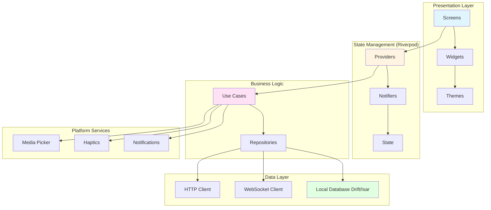

# Design Document: Client UI System

## Overview

The Client UI System provides a beautiful, minimalist, and highly performant user interface for the instant messaging application across iOS, Android, and Desktop platforms. Built with Flutter, it emphasizes Neo-Minimalism design principles with generous whitespace, subtle animations, and intuitive interactions.

Key design principles:
- **Neo-Minimalism**: Clean, spacious design with focus on content
- **Performance**: 60/120fps smooth animations and scrolling
- **Platform-adaptive**: Native feel on each platform (Cupertino/Material 3)
- **Micro-interactions**: Subtle feedback for every user action
- **Offline-first**: Local database as single source of truth

## Architecture

### High-Level Architecture



## Design System

### Color Palette

```dart
// Light Theme
class LightColors {
  static const primary = Color(0xFF2196F3);      // Blue accent
  static const background = Color(0xFFFFFFFF);   // Pure white
  static const surface = Color(0xFFF5F5F5);      // Light gray
  static const text = Color(0xFF212121);         // Near black
  static const textSecondary = Color(0xFF757575); // Gray
  static const divider = Color(0xFFE0E0E0);      // Light divider
  static const success = Color(0xFF4CAF50);      // Green
  static const error = Color(0xFFF44336);        // Red
}

// Dark Theme
class DarkColors {
  static const primary = Color(0xFF64B5F6);      // Light blue
  static const background = Color(0xFF000000);   // Pure black (OLED)
  static const surface = Color(0xFF121212);      // Dark gray
  static const text = Color(0xFFFFFFFF);         // White
  static const textSecondary = Color(0xFFB0B0B0); // Light gray
  static const divider = Color(0xFF2C2C2C);      // Dark divider
  static const success = Color(0xFF81C784);      // Light green
  static const error = Color(0xFFE57373);        // Light red
}
```

### Typography

```dart
class AppTypography {
  static const fontFamily = 'SF Pro Display'; // iOS
  // Android uses 'Product Sans' or system default
  
  static const h1 = TextStyle(
    fontSize: 32,
    fontWeight: FontWeight.w700,
    height: 1.5,
    letterSpacing: -0.5,
  );
  
  static const h2 = TextStyle(
    fontSize: 24,
    fontWeight: FontWeight.w600,
    height: 1.5,
  );
  
  static const body = TextStyle(
    fontSize: 16,
    fontWeight: FontWeight.w400,
    height: 1.5,
  );
  
  static const caption = TextStyle(
    fontSize: 12,
    fontWeight: FontWeight.w400,
    height: 1.5,
    color: Colors.textSecondary,
  );
}
```

### Spacing System

```dart
class Spacing {
  static const xxs = 4.0;
  static const xs = 8.0;
  static const sm = 12.0;
  static const md = 16.0;
  static const lg = 24.0;
  static const xl = 32.0;
  static const xxl = 48.0;
}
```

## Key Components

### 1. Message Bubble

```dart
class MessageBubble extends StatelessWidget {
  final Message message;
  final bool isSent;
  
  @override
  Widget build(BuildContext context) {
    return Container(
      margin: EdgeInsets.symmetric(
        horizontal: Spacing.md,
        vertical: Spacing.xs,
      ),
      child: Row(
        mainAxisAlignment: isSent 
          ? MainAxisAlignment.end 
          : MainAxisAlignment.start,
        children: [
          if (!isSent) Avatar(user: message.sender),
          SizedBox(width: Spacing.xs),
          Flexible(
            child: Container(
              padding: EdgeInsets.all(Spacing.md),
              decoration: BoxDecoration(
                color: isSent 
                  ? Theme.of(context).primaryColor 
                  : Theme.of(context).surfaceColor,
                borderRadius: BorderRadius.circular(20),
                boxShadow: [
                  BoxShadow(
                    color: Colors.black.withOpacity(0.05),
                    blurRadius: 8,
                    offset: Offset(0, 2),
                  ),
                ],
              ),
              child: Column(
                crossAxisAlignment: CrossAxisAlignment.start,
                children: [
                  Text(message.content),
                  SizedBox(height: Spacing.xxs),
                  Row(
                    mainAxisSize: MainAxisSize.min,
                    children: [
                      Text(
                        formatTime(message.timestamp),
                        style: AppTypography.caption,
                      ),
                      if (isSent) ...[
                        SizedBox(width: Spacing.xxs),
                        MessageStatusIcon(status: message.status),
                      ],
                    ],
                  ),
                ],
              ),
            ),
          ),
        ],
      ),
    );
  }
}
```

### 2. Conversation List Item

```dart
class ConversationListItem extends StatelessWidget {
  final Conversation conversation;
  
  @override
  Widget build(BuildContext context) {
    return InkWell(
      onTap: () => navigateToChat(conversation),
      child: Container(
        padding: EdgeInsets.all(Spacing.md),
        child: Row(
          children: [
            Stack(
              children: [
                Avatar(
                  user: conversation.otherUser,
                  size: 56,
                ),
                if (conversation.otherUser.isOnline)
                  Positioned(
                    right: 0,
                    bottom: 0,
                    child: OnlineIndicator(),
                  ),
              ],
            ),
            SizedBox(width: Spacing.md),
            Expanded(
              child: Column(
                crossAxisAlignment: CrossAxisAlignment.start,
                children: [
                  Row(
                    mainAxisAlignment: MainAxisAlignment.spaceBetween,
                    children: [
                      Text(
                        conversation.otherUser.username,
                        style: AppTypography.body.copyWith(
                          fontWeight: FontWeight.w600,
                        ),
                      ),
                      Text(
                        formatTimestamp(conversation.lastMessage.timestamp),
                        style: AppTypography.caption,
                      ),
                    ],
                  ),
                  SizedBox(height: Spacing.xxs),
                  Row(
                    children: [
                      Expanded(
                        child: Text(
                          conversation.lastMessage.preview,
                          style: AppTypography.body.copyWith(
                            color: Colors.textSecondary,
                          ),
                          maxLines: 1,
                          overflow: TextOverflow.ellipsis,
                        ),
                      ),
                      if (conversation.unreadCount > 0)
                        UnreadBadge(count: conversation.unreadCount),
                    ],
                  ),
                ],
              ),
            ),
          ],
        ),
      ),
    );
  }
}
```

### 3. Chat Input

```dart
class ChatInput extends StatefulWidget {
  final Function(String) onSend;
  final Function() onMediaTap;
  
  @override
  _ChatInputState createState() => _ChatInputState();
}

class _ChatInputState extends State<ChatInput> {
  final _controller = TextEditingController();
  bool _hasText = false;
  
  @override
  Widget build(BuildContext context) {
    return Container(
      padding: EdgeInsets.all(Spacing.md),
      decoration: BoxDecoration(
        color: Theme.of(context).surfaceColor,
        boxShadow: [
          BoxShadow(
            color: Colors.black.withOpacity(0.05),
            blurRadius: 8,
            offset: Offset(0, -2),
          ),
        ],
      ),
      child: Row(
        children: [
          IconButton(
            icon: Icon(Icons.add_photo_alternate),
            onPressed: widget.onMediaTap,
          ),
          Expanded(
            child: TextField(
              controller: _controller,
              decoration: InputDecoration(
                hintText: 'Message...',
                border: OutlineInputBorder(
                  borderRadius: BorderRadius.circular(24),
                  borderSide: BorderSide.none,
                ),
                filled: true,
                fillColor: Theme.of(context).backgroundColor,
                contentPadding: EdgeInsets.symmetric(
                  horizontal: Spacing.md,
                  vertical: Spacing.sm,
                ),
              ),
              onChanged: (text) {
                setState(() => _hasText = text.isNotEmpty);
              },
            ),
          ),
          SizedBox(width: Spacing.xs),
          AnimatedScale(
            scale: _hasText ? 1.0 : 0.0,
            duration: Duration(milliseconds: 200),
            child: IconButton(
              icon: Icon(Icons.send),
              onPressed: _hasText ? _sendMessage : null,
            ),
          ),
        ],
      ),
    );
  }
  
  void _sendMessage() {
    if (_hasText) {
      widget.onSend(_controller.text);
      _controller.clear();
      setState(() => _hasText = false);
      HapticFeedback.lightImpact();
    }
  }
}
```

## State Management (Riverpod)

### Providers Structure

```dart
// Message providers
final messagesProvider = StateNotifierProvider<MessagesNotifier, AsyncValue<List<Message>>>((ref) {
  return MessagesNotifier(ref.read(messageRepositoryProvider));
});

final conversationsProvider = StateNotifierProvider<ConversationsNotifier, AsyncValue<List<Conversation>>>((ref) {
  return ConversationsNotifier(ref.read(conversationRepositoryProvider));
});

// User providers
final currentUserProvider = StateProvider<User?>((ref) => null);

final onlineStatusProvider = StreamProvider.family<bool, String>((ref, userId) {
  return ref.read(userRepositoryProvider).watchOnlineStatus(userId);
});

// UI state providers
final selectedConversationProvider = StateProvider<String?>((ref) => null);

final typingIndicatorProvider = StreamProvider.family<bool, String>((ref, conversationId) {
  return ref.read(messageRepositoryProvider).watchTypingIndicator(conversationId);
});
```

## Performance Optimizations

### 1. Efficient List Rendering

```dart
ListView.builder(
  itemCount: messages.length,
  itemBuilder: (context, index) {
    return MessageBubble(
      key: ValueKey(messages[index].id),
      message: messages[index],
    );
  },
  cacheExtent: 1000, // Pre-render items
);
```

### 2. Image Caching

```dart
CachedNetworkImage(
  imageUrl: imageUrl,
  placeholder: (context, url) => ShimmerPlaceholder(),
  errorWidget: (context, url, error) => Icon(Icons.error),
  memCacheWidth: 800, // Limit memory usage
  maxWidthDiskCache: 1920,
);
```

### 3. Lazy Loading

```dart
class InfiniteScrollList extends StatefulWidget {
  @override
  _InfiniteScrollListState createState() => _InfiniteScrollListState();
}

class _InfiniteScrollListState extends State<InfiniteScrollList> {
  final _scrollController = ScrollController();
  
  @override
  void initState() {
    super.initState();
    _scrollController.addListener(_onScroll);
  }
  
  void _onScroll() {
    if (_scrollController.position.pixels >= 
        _scrollController.position.maxScrollExtent - 200) {
      // Load more items
      context.read(messagesProvider.notifier).loadMore();
    }
  }
}
```

## Platform Adaptations

### iOS (Cupertino)

```dart
if (Platform.isIOS) {
  return CupertinoPageScaffold(
    navigationBar: CupertinoNavigationBar(
      middle: Text('Chat'),
    ),
    child: ChatView(),
  );
}
```

### Android (Material 3)

```dart
if (Platform.isAndroid) {
  return Scaffold(
    appBar: AppBar(
      title: Text('Chat'),
    ),
    body: ChatView(),
  );
}
```

### Desktop

```dart
if (Platform.isDesktop) {
  return Row(
    children: [
      SizedBox(
        width: 300,
        child: ConversationList(),
      ),
      VerticalDivider(width: 1),
      Expanded(
        child: ChatView(),
      ),
      if (showDetails)
        SizedBox(
          width: 300,
          child: ChatDetails(),
        ),
    ],
  );
}
```

## Animations

### Micro-interactions

```dart
// Message send animation
AnimatedOpacity(
  opacity: isSending ? 0.5 : 1.0,
  duration: Duration(milliseconds: 200),
  child: MessageBubble(message: message),
);

// Swipe to reply
Dismissible(
  key: Key(message.id),
  direction: DismissDirection.startToEnd,
  confirmDismiss: (direction) async {
    onReply(message);
    return false; // Don't actually dismiss
  },
  background: Container(
    alignment: Alignment.centerLeft,
    padding: EdgeInsets.only(left: Spacing.lg),
    child: Icon(Icons.reply),
  ),
  child: MessageBubble(message: message),
);
```

## Testing Strategy

### Widget Tests
- Test individual components render correctly
- Test user interactions trigger correct callbacks
- Test state changes update UI properly

### Integration Tests
- Test full user flows (login → chat → send message)
- Test navigation between screens
- Test offline/online state handling

### Performance Tests
- Measure frame rate during scrolling
- Measure memory usage with large message lists
- Measure app startup time

## Key Properties (Summary)

Property 1: 60/120fps scrolling performance
Property 2: Immediate visual feedback (<16ms)
Property 3: Smooth animations (200-300ms)
Property 4: Real-time message updates
Property 5: Efficient list rendering with ListView.builder
Property 6: Proper skeleton screen display
Property 7: Platform-adaptive UI (Cupertino/Material 3)
Property 8: Offline data access from local database
Property 9: Proper error handling and user feedback
Property 10: Consistent component styling
Property 11: Haptic feedback on supported devices
Property 12: Proper notification handling
Property 13: Theme switching animation
Property 14: Search result highlighting
Property 15: Media preview and full-screen viewer
Property 16: Typing indicator display
Property 17: Message status display (sending/sent/delivered/read)
Property 18: Unread badge display
Property 19: Online status indicator
Property 20: Swipe gesture support

