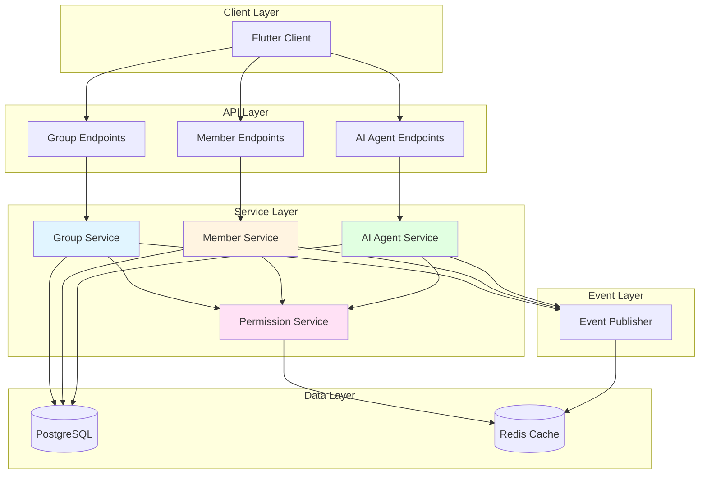
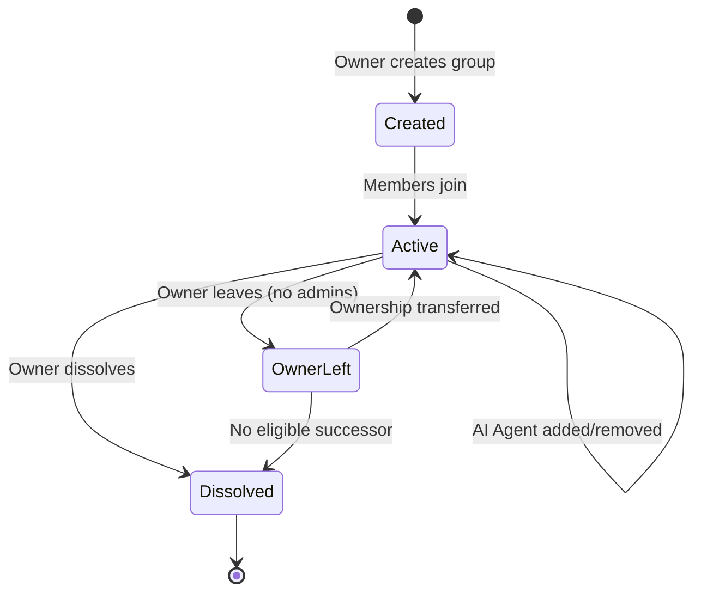

# Design Document: Group Chat Management System

## Overview

The Group Chat Management System provides comprehensive group lifecycle management, member administration, permission control, and AI Agent integration for the instant messaging application. It enables users to create groups, manage members with role-based permissions, and integrate AI Agents for enhanced chat experiences.

The system is designed with flexibility and scalability in mind, supporting groups from small private chats to large public communities, while maintaining the application's minimalist design philosophy.

Key design principles:
- **Role-based permissions**: Clear hierarchy (owner > admin > member)
- **Flexible membership**: Easy invite mechanisms (direct invite, invite codes)
- **AI integration**: Seamless AI Agent addition and configuration
- **Scalability**: Support for large groups (up to 500 members)
- **Auditability**: Comprehensive logging of all management actions

## Architecture

### High-Level Architecture



### Group Lifecycle Flow



## Components and Interfaces

### 1. Group Service

**Responsibility**: Manage group lifecycle, settings, and information

**Interface**:
```rust
#[async_trait]
pub trait GroupService {
    async fn create_group(
        &self,
        owner_id: Uuid,
        name: String,
        description: Option<String>,
        avatar: Option<String>,
        is_public: bool,
    ) -> Result<Group>;
    
    async fn get_group(&self, group_id: Uuid) -> Result<Group>;
    
    async fn update_group_settings(
        &self,
        group_id: Uuid,
        actor_id: Uuid,
        updates: GroupSettingsUpdate,
    ) -> Result<Group>;
    
    async fn dissolve_group(
        &self,
        group_id: Uuid,
        actor_id: Uuid,
    ) -> Result<()>;
    
    async fn search_groups(
        &self,
        query: String,
        limit: usize,
    ) -> Result<Vec<GroupSearchResult>>;
    
    async fn get_group_details(
        &self,
        group_id: Uuid,
        requester_id: Option<Uuid>,
    ) -> Result<GroupDetails>;
}

pub struct Group {
    pub id: Uuid,
    pub name: String,
    pub description: Option<String>,
    pub avatar: Option<String>,
    pub owner_id: Uuid,
    pub is_public: bool,
    pub member_count: i32,
    pub max_capacity: i32,
    pub status: GroupStatus,
    pub created_at: i64,
    pub updated_at: i64,
}

pub enum GroupStatus {
    Active,
    Dissolved,
}

pub struct GroupSettingsUpdate {
    pub name: Option<String>,
    pub description: Option<String>,
    pub avatar: Option<String>,
    pub is_public: Option<bool>,
}
```

**Implementation Strategy**:
- Validate group name (1-50 chars), description (max 500 chars)
- Generate unique UUID for group ID
- Set default capacity to 500 members
- Publish group events to Redis for real-time updates
- Cache group information in Redis with 5-minute TTL
- Implement soft delete for dissolved groups (retain for compliance)

### 2. Member Service

**Responsibility**: Manage group membership, roles, and member actions

**Interface**:
```rust
#[async_trait]
pub trait MemberService {
    async fn add_member(
        &self,
        group_id: Uuid,
        user_id: Uuid,
        inviter_id: Uuid,
    ) -> Result<GroupMember>;
    
    async fn remove_member(
        &self,
        group_id: Uuid,
        user_id: Uuid,
        actor_id: Uuid,
    ) -> Result<()>;
    
    async fn leave_group(
        &self,
        group_id: Uuid,
        user_id: Uuid,
    ) -> Result<()>;
    
    async fn update_member_role(
        &self,
        group_id: Uuid,
        user_id: Uuid,
        new_role: MemberRole,
        actor_id: Uuid,
    ) -> Result<GroupMember>;
    
    async fn mute_member(
        &self,
        group_id: Uuid,
        user_id: Uuid,
        actor_id: Uuid,
    ) -> Result<()>;
    
    async fn unmute_member(
        &self,
        group_id: Uuid,
        user_id: Uuid,
        actor_id: Uuid,
    ) -> Result<()>;
    
    async fn ban_member(
        &self,
        group_id: Uuid,
        user_id: Uuid,
        actor_id: Uuid,
        reason: Option<String>,
    ) -> Result<()>;
    
    async fn unban_member(
        &self,
        group_id: Uuid,
        user_id: Uuid,
        actor_id: Uuid,
    ) -> Result<()>;
    
    async fn get_group_members(
        &self,
        group_id: Uuid,
        page: usize,
        limit: usize,
    ) -> Result<Vec<GroupMemberInfo>>;
    
    async fn is_member(
        &self,
        group_id: Uuid,
        user_id: Uuid,
    ) -> Result<bool>;
    
    async fn is_banned(
        &self,
        group_id: Uuid,
        user_id: Uuid,
    ) -> Result<bool>;
}

pub struct GroupMember {
    pub group_id: Uuid,
    pub user_id: Uuid,
    pub role: MemberRole,
    pub is_muted: bool,
    pub joined_at: i64,
}

pub enum MemberRole {
    Owner,
    Admin,
    Member,
}

pub struct GroupMemberInfo {
    pub user_id: Uuid,
    pub username: String,
    pub avatar: Option<String>,
    pub role: MemberRole,
    pub is_muted: bool,
    pub online: bool,
    pub joined_at: i64,
}
```

**Implementation Strategy**:
- Check group capacity before adding members
- Verify permissions before role changes
- Prevent admins from kicking owner or other admins
- Handle ownership transfer when owner leaves
- Publish member events (join, leave, kick, role change) to Redis
- Cache member lists with pagination
- Track banned users in separate table

### 3. Permission Service

**Responsibility**: Verify user permissions for group actions

**Interface**:
```rust
#[async_trait]
pub trait PermissionService {
    async fn check_permission(
        &self,
        group_id: Uuid,
        user_id: Uuid,
        required_permission: Permission,
    ) -> Result<bool>;
    
    async fn get_user_role(
        &self,
        group_id: Uuid,
        user_id: Uuid,
    ) -> Result<Option<MemberRole>>;
    
    async fn can_invite_members(
        &self,
        group_id: Uuid,
        user_id: Uuid,
    ) -> Result<bool>;
    
    async fn can_remove_members(
        &self,
        group_id: Uuid,
        actor_id: Uuid,
        target_id: Uuid,
    ) -> Result<bool>;
    
    async fn can_update_settings(
        &self,
        group_id: Uuid,
        user_id: Uuid,
    ) -> Result<bool>;
    
    async fn can_manage_ai_agent(
        &self,
        group_id: Uuid,
        user_id: Uuid,
    ) -> Result<bool>;
}

pub enum Permission {
    ViewGroup,
    SendMessage,
    InviteMembers,
    RemoveMembers,
    UpdateSettings,
    ManageRoles,
    ManageAIAgent,
    DissolveGroup,
}
```

**Implementation Strategy**:
- Cache user roles in Redis with 5-minute TTL
- Invalidate cache on role changes
- Implement permission matrix:
  - Owner: All permissions
  - Admin: All except ManageRoles, DissolveGroup
  - Member: ViewGroup, SendMessage
- Check mute status for SendMessage permission
- Check ban status before any action

### 4. Invite Service

**Responsibility**: Manage group invitations and invite codes

**Interface**:
```rust
#[async_trait]
pub trait InviteService {
    async fn generate_invite_code(
        &self,
        group_id: Uuid,
        creator_id: Uuid,
        expires_at: Option<i64>,
    ) -> Result<InviteCode>;
    
    async fn join_via_invite_code(
        &self,
        code: String,
        user_id: Uuid,
    ) -> Result<Group>;
    
    async fn revoke_invite_code(
        &self,
        code: String,
        actor_id: Uuid,
    ) -> Result<()>;
    
    async fn get_group_invite_codes(
        &self,
        group_id: Uuid,
        actor_id: Uuid,
    ) -> Result<Vec<InviteCode>>;
}

pub struct InviteCode {
    pub code: String,
    pub group_id: Uuid,
    pub creator_id: Uuid,
    pub usage_count: i32,
    pub max_uses: Option<i32>,
    pub expires_at: Option<i64>,
    pub created_at: i64,
}
```

**Implementation Strategy**:
- Generate 8-character alphanumeric codes
- Store codes in database with expiration
- Validate code before allowing join
- Optionally track usage count
- Support code revocation by owner/admin

### 5. AI Agent Integration Service

**Responsibility**: Manage AI Agent addition, removal, and configuration in groups

**Interface**:
```rust
#[async_trait]
pub trait GroupAIAgentService {
    async fn add_ai_agent(
        &self,
        group_id: Uuid,
        actor_id: Uuid,
        config: AIAgentConfig,
    ) -> Result<GroupAIAgent>;
    
    async fn remove_ai_agent(
        &self,
        group_id: Uuid,
        actor_id: Uuid,
    ) -> Result<()>;
    
    async fn update_ai_agent_config(
        &self,
        group_id: Uuid,
        actor_id: Uuid,
        config: AIAgentConfig,
    ) -> Result<GroupAIAgent>;
    
    async fn get_ai_agent(
        &self,
        group_id: Uuid,
    ) -> Result<Option<GroupAIAgent>>;
}

pub struct GroupAIAgent {
    pub group_id: Uuid,
    pub agent_id: Uuid,
    pub config: AIAgentConfig,
    pub created_at: i64,
    pub updated_at: i64,
}

pub struct AIAgentConfig {
    pub name: String,
    pub toxicity_level: u8,
    pub enthusiasm_level: u8,
    pub expertise_domains: Vec<String>,
    pub speech_suffix: Option<String>,
}
```

**Implementation Strategy**:
- Enforce one AI Agent per group
- Validate personality parameters (0-10 range)
- Publish agent events to AI Agent System
- Store configuration in database
- Link to AI Agent System for actual agent logic

### 6. Event Publisher

**Responsibility**: Publish group events for real-time updates

**Interface**:
```rust
#[async_trait]
pub trait GroupEventPublisher {
    async fn publish_group_created(&self, group: &Group) -> Result<()>;
    
    async fn publish_group_updated(&self, group: &Group) -> Result<()>;
    
    async fn publish_group_dissolved(&self, group_id: Uuid) -> Result<()>;
    
    async fn publish_member_joined(
        &self,
        group_id: Uuid,
        member: &GroupMemberInfo,
    ) -> Result<()>;
    
    async fn publish_member_left(
        &self,
        group_id: Uuid,
        user_id: Uuid,
    ) -> Result<()>;
    
    async fn publish_member_kicked(
        &self,
        group_id: Uuid,
        user_id: Uuid,
        actor_id: Uuid,
    ) -> Result<()>;
    
    async fn publish_role_changed(
        &self,
        group_id: Uuid,
        user_id: Uuid,
        old_role: MemberRole,
        new_role: MemberRole,
    ) -> Result<()>;
    
    async fn publish_ai_agent_added(
        &self,
        group_id: Uuid,
        agent: &GroupAIAgent,
    ) -> Result<()>;
}
```

**Implementation Strategy**:
- Publish to Redis channels: `group:{group_id}:events`
- Include event type, timestamp, and relevant data
- All group members subscribe to group event channel
- Use for real-time UI updates

## Data Models

### Database Schema

```sql
-- Groups table
CREATE TABLE groups (
    id UUID PRIMARY KEY DEFAULT gen_random_uuid(),
    name VARCHAR(50) NOT NULL,
    description VARCHAR(500),
    avatar TEXT,
    owner_id UUID NOT NULL REFERENCES users(id),
    is_public BOOLEAN DEFAULT FALSE,
    member_count INTEGER DEFAULT 1,
    max_capacity INTEGER DEFAULT 500,
    status VARCHAR(20) DEFAULT 'active',
    created_at TIMESTAMP DEFAULT NOW(),
    updated_at TIMESTAMP DEFAULT NOW(),
    
    CHECK (char_length(name) >= 1),
    CHECK (status IN ('active', 'dissolved'))
);

CREATE INDEX idx_groups_owner ON groups(owner_id);
CREATE INDEX idx_groups_status ON groups(status) WHERE status = 'active';
CREATE INDEX idx_groups_public ON groups(is_public) WHERE is_public = TRUE AND status = 'active';
CREATE INDEX idx_groups_name ON groups(name) WHERE status = 'active';

-- Group members table
CREATE TABLE group_members (
    group_id UUID NOT NULL REFERENCES groups(id),
    user_id UUID NOT NULL REFERENCES users(id),
    role VARCHAR(20) NOT NULL DEFAULT 'member',
    is_muted BOOLEAN DEFAULT FALSE,
    joined_at TIMESTAMP DEFAULT NOW(),
    
    PRIMARY KEY (group_id, user_id),
    CHECK (role IN ('owner', 'admin', 'member'))
);

CREATE INDEX idx_group_members_user ON group_members(user_id);
CREATE INDEX idx_group_members_role ON group_members(group_id, role);

-- Group bans table
CREATE TABLE group_bans (
    group_id UUID NOT NULL REFERENCES groups(id),
    user_id UUID NOT NULL REFERENCES users(id),
    banned_by UUID NOT NULL REFERENCES users(id),
    reason TEXT,
    banned_at TIMESTAMP DEFAULT NOW(),
    
    PRIMARY KEY (group_id, user_id)
);

CREATE INDEX idx_group_bans_user ON group_bans(user_id);

-- Group invite codes table
CREATE TABLE group_invite_codes (
    code VARCHAR(8) PRIMARY KEY,
    group_id UUID NOT NULL REFERENCES groups(id),
    creator_id UUID NOT NULL REFERENCES users(id),
    usage_count INTEGER DEFAULT 0,
    max_uses INTEGER,
    expires_at TIMESTAMP,
    created_at TIMESTAMP DEFAULT NOW()
);

CREATE INDEX idx_invite_codes_group ON group_invite_codes(group_id);
CREATE INDEX idx_invite_codes_expiry ON group_invite_codes(expires_at) WHERE expires_at IS NOT NULL;

-- Group AI agents table
CREATE TABLE group_ai_agents (
    group_id UUID PRIMARY KEY REFERENCES groups(id),
    agent_id UUID NOT NULL REFERENCES ai_agents(id),
    created_at TIMESTAMP DEFAULT NOW(),
    updated_at TIMESTAMP DEFAULT NOW()
);

-- Group audit log table
CREATE TABLE group_audit_log (
    id BIGSERIAL PRIMARY KEY,
    group_id UUID NOT NULL REFERENCES groups(id),
    actor_id UUID REFERENCES users(id),
    action_type VARCHAR(50) NOT NULL,
    target_user_id UUID REFERENCES users(id),
    old_value TEXT,
    new_value TEXT,
    reason TEXT,
    metadata JSONB,
    created_at TIMESTAMP DEFAULT NOW()
);

CREATE INDEX idx_group_audit_group ON group_audit_log(group_id, created_at DESC);
CREATE INDEX idx_group_audit_actor ON group_audit_log(actor_id, created_at DESC);
CREATE INDEX idx_group_audit_action ON group_audit_log(action_type, created_at DESC);
```

### Redis Data Structures

```rust
// Permission cache: key = "group_perm:{group_id}:{user_id}", value = role, TTL = 5 minutes
// Member list cache: key = "group_members:{group_id}:page:{page}", value = JSON, TTL = 5 minutes
// Group info cache: key = "group_info:{group_id}", value = JSON, TTL = 5 minutes
// Ban check cache: key = "group_ban:{group_id}:{user_id}", value = "1", TTL = 10 minutes
```


## Correctness Properties

*A property is a characteristic or behavior that should hold true across all valid executions of a system—essentially, a formal statement about what the system should do. Properties serve as the bridge between human-readable specifications and machine-verifiable correctness guarantees.*


### Key Correctness Properties (Summary)

Due to the comprehensive nature of this system, here are the most critical properties:

**Group Creation & Management (Requirements 1, 4, 11)**:
- Property 1: Group name validation (1-50 characters)
- Property 2: Unique UUID generation for groups
- Property 3: Creator assigned as owner with full permissions
- Property 4: Default capacity set to 500 members
- Property 5: Group settings update validation (name, avatar, description)
- Property 6: Only owner can dissolve group

**Membership Management (Requirements 2, 3, 6, 7, 10)**:
- Property 7: Capacity check before adding members
- Property 8: Member added with correct role
- Property 9: Join event published to all members
- Property 10: Duplicate member rejection
- Property 11: Invite code validation (8 chars, not expired)
- Property 12: Permission verification for member removal
- Property 13: Admins cannot kick owner or other admins
- Property 14: Kicked member removal and event publication
- Property 15: Banned user cannot rejoin
- Property 16: Owner leaving triggers ownership transfer or dissolution

**Role & Permission Management (Requirements 5, 8, 16)**:
- Property 17: Only owner can promote to admin
- Property 18: Role change event publication
- Property 19: Mute status prevents message sending
- Property 20: Permission cache with 5-minute TTL
- Property 21: Permission verification for all actions
- Property 22: Cache invalidation on role changes

**AI Agent Integration (Requirements 12, 13)**:
- Property 23: One AI Agent per group limit
- Property 24: Agent configuration validation
- Property 25: Agent event publication to members

**Search & Discovery (Requirements 9, 14, 15)**:
- Property 26: Member list pagination (100 per page)
- Property 27: Member list ordering (role, then join date)
- Property 28: Public group search with partial matching
- Property 29: Search result limit (20 groups)
- Property 30: Group details include requester's role

**Audit & Logging (Requirement 17)**:
- Property 31: All management actions logged
- Property 32: Audit logs include actor, timestamp, and details

## Error Handling

### Error Categories

1. **Validation Errors**: Invalid group name, description too long, invalid invite code
2. **Permission Errors**: Insufficient permissions, not a member, cannot kick admin
3. **Capacity Errors**: Group full, cannot add more members
4. **State Errors**: Group dissolved, user banned, already a member
5. **System Errors**: Database failures, Redis unavailable

### Graceful Degradation

- Redis cache failures: Fall back to database queries
- Event publication failures: Log error, continue operation
- AI Agent service unavailable: Allow group operations, skip agent notifications

## Testing Strategy

### Unit Testing
- Group creation with various inputs
- Member addition/removal with permission checks
- Role changes and validation
- Invite code generation and validation
- AI Agent configuration validation

### Property-Based Testing
Use `proptest` with 100+ iterations per property:
- Group name validation across random inputs
- Permission checks across all role combinations
- Capacity limits with random member counts
- Invite code uniqueness and expiration
- Member list pagination correctness

### Integration Testing
- Full group lifecycle (create → add members → update → dissolve)
- Ownership transfer scenarios
- AI Agent integration flow
- Event publication and subscription
- Permission caching and invalidation

### Performance Testing
- Group creation throughput: 50/second
- Member addition: 100/second
- Permission checks: < 5ms (cached), < 20ms (uncached)
- Member list retrieval: < 50ms for 500 members
- Search performance: < 100ms

