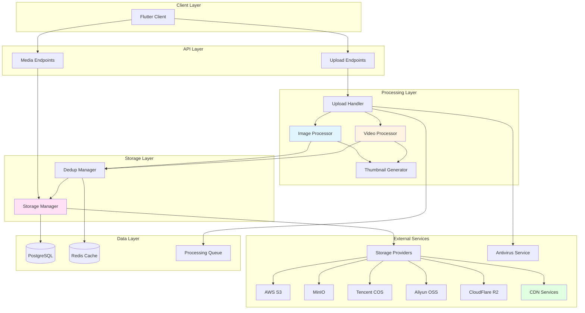

# Design Document: Media Processing System

## Overview

The Media Processing System handles all media file operations including upload, compression, storage, and delivery. It optimizes images and videos for efficient storage and fast delivery while maintaining quality, using modern formats (WebP, H.264/H.265) and CDN distribution.

Key design principles:
- **Quality optimization**: Balance between file size and visual quality
- **Fast processing**: Async processing with queue management
- **Cost efficiency**: Deduplication, lifecycle management, CDN caching
- **Security**: Malware scanning, access control, presigned URLs
- **Scalability**: Concurrent processing, object storage, CDN

## Architecture

### High-Level Architecture



## Components and Interfaces

### 1. Upload Handler

**Responsibility**: Handle upload requests, generate presigned URLs, coordinate processing

**Interface**:
```rust
#[async_trait]
pub trait UploadHandler {
    async fn request_image_upload(
        &self,
        user_id: Uuid,
        file_size: u64,
        mime_type: String,
    ) -> Result<UploadToken>;
    
    async fn request_video_upload(
        &self,
        user_id: Uuid,
        file_size: u64,
        mime_type: String,
    ) -> Result<UploadToken>;
    
    async fn complete_upload(
        &self,
        token: String,
        file_hash: String,
    ) -> Result<MediaFile>;
}

pub struct UploadToken {
    pub token: String,
    pub upload_url: String,
    pub expires_at: i64,
}
```

**Implementation Strategy**:
- Validate file size (10MB for images, 100MB for videos)
- Validate MIME types
- Generate presigned S3 URLs (15 min for images, 30 min for videos)
- Queue processing tasks
- Scan for malware

### 2. Image Processor

**Responsibility**: Compress and optimize images

**Interface**:
```rust
#[async_trait]
pub trait ImageProcessor {
    async fn process_image(&self, input_path: &str) -> Result<ProcessedImage>;
}

pub struct ProcessedImage {
    pub original_path: String,
    pub webp_path: String,
    pub thumbnail_path: String,
    pub width: u32,
    pub height: u32,
    pub file_size: u64,
}
```

**Implementation Strategy**:
- Convert to WebP (85% quality)
- Resize if > 1920px (maintain aspect ratio)
- Generate 200px thumbnail
- Use `image` crate for processing

### 3. Video Processor

**Responsibility**: Compress and optimize videos

**Interface**:
```rust
#[async_trait]
pub trait VideoProcessor {
    async fn process_video(&self, input_path: &str) -> Result<ProcessedVideo>;
}

pub struct ProcessedVideo {
    pub original_path: String,
    pub compressed_path: String,
    pub thumbnail_path: String,
    pub width: u32,
    pub height: u32,
    pub duration: f64,
    pub file_size: u64,
}
```

**Implementation Strategy**:
- Use ffmpeg for compression (H.264/H.265, CRF 23-28)
- Downscale to 1080p if needed
- Extract first frame as thumbnail (400px)
- Process async in background

### 4. Storage Manager

**Responsibility**: Manage file storage across multiple cloud providers

**Interface**:
```rust
#[async_trait]
pub trait StorageProvider: Send + Sync {
    async fn upload_file(
        &self,
        local_path: &str,
        key: &str,
        content_type: &str,
    ) -> Result<String>;
    
    async fn generate_presigned_url(
        &self,
        key: &str,
        expires_in: Duration,
    ) -> Result<String>;
    
    async fn get_public_url(&self, key: &str) -> String;
    
    async fn get_cdn_url(&self, key: &str) -> Option<String>;
    
    async fn delete_file(&self, key: &str) -> Result<()>;
}

pub struct StorageManager {
    image_provider: Arc<dyn StorageProvider>,
    video_provider: Arc<dyn StorageProvider>,
}

pub enum StorageProviderType {
    AwsS3,
    MinIO,
    TencentCOS,
    AliyunOSS,
    CloudFlareR2,
}
```

**Implementation Strategy**:
- Define unified `StorageProvider` trait for all providers
- Implement provider-specific adapters:
  - `AwsS3Provider`: AWS S3 SDK
  - `MinIOProvider`: S3-compatible API
  - `TencentCOSProvider`: Tencent Cloud SDK
  - `AliyunOSSProvider`: Aliyun SDK
  - `CloudFlareR2Provider`: S3-compatible API with R2 endpoint
- Support separate providers for images and videos
- Configure CDN per provider
- Set cache headers (30 days)
- Implement lifecycle policies per provider

### 5. Deduplication Manager

**Responsibility**: Prevent duplicate file storage

**Interface**:
```rust
#[async_trait]
pub trait DeduplicationManager {
    async fn check_duplicate(&self, file_hash: &str) -> Result<Option<Uuid>>;
    
    async fn register_file(&self, file_hash: &str, media_id: Uuid) -> Result<()>;
    
    async fn increment_ref_count(&self, media_id: Uuid) -> Result<()>;
    
    async fn decrement_ref_count(&self, media_id: Uuid) -> Result<bool>;
}
```

**Implementation Strategy**:
- Calculate SHA-256 hash
- Check Redis cache first, then database
- Track reference counts
- Delete when count reaches zero

## Data Models

### Database Schema

```sql
CREATE TABLE media_files (
    id UUID PRIMARY KEY DEFAULT gen_random_uuid(),
    uploader_id UUID NOT NULL REFERENCES users(id),
    file_hash VARCHAR(64) UNIQUE NOT NULL,
    media_type VARCHAR(20) NOT NULL,  -- image, video
    mime_type VARCHAR(50) NOT NULL,
    storage_provider VARCHAR(20) NOT NULL,  -- aws_s3, minio, tencent_cos, aliyun_oss, cloudflare_r2
    original_url TEXT NOT NULL,
    processed_url TEXT,
    thumbnail_url TEXT,
    width INTEGER,
    height INTEGER,
    duration REAL,  -- for videos
    file_size BIGINT NOT NULL,
    ref_count INTEGER DEFAULT 1,
    status VARCHAR(20) DEFAULT 'processing',
    created_at TIMESTAMP DEFAULT NOW(),
    updated_at TIMESTAMP DEFAULT NOW(),
    
    CHECK (media_type IN ('image', 'video')),
    CHECK (status IN ('processing', 'completed', 'failed')),
    CHECK (storage_provider IN ('aws_s3', 'minio', 'tencent_cos', 'aliyun_oss', 'cloudflare_r2'))
);

CREATE INDEX idx_media_hash ON media_files(file_hash);
CREATE INDEX idx_media_uploader ON media_files(uploader_id);
CREATE INDEX idx_media_status ON media_files(status);
CREATE INDEX idx_media_provider ON media_files(storage_provider);

CREATE TABLE media_metadata (
    media_id UUID PRIMARY KEY REFERENCES media_files(id),
    format VARCHAR(20),
    codec VARCHAR(50),
    bitrate INTEGER,
    framerate REAL,
    metadata JSONB
);
```

### Configuration Model

```rust
pub struct StorageConfig {
    pub provider_type: StorageProviderType,
    pub region: Option<String>,
    pub endpoint: Option<String>,
    pub bucket: String,
    pub access_key: String,
    pub secret_key: String,
    pub cdn_domain: Option<String>,
}

pub struct MediaStorageConfig {
    pub image_storage: StorageConfig,
    pub video_storage: StorageConfig,
}
```

## Correctness Properties

*A property is a characteristic or behavior that should hold true across all valid executions of a system-essentially, a formal statement about what the system should do. Properties serve as the bridge between human-readable specifications and machine-verifiable correctness guarantees.*

### Core Processing Properties

Property 1: Image size validation
*For any* image upload request, if the file size exceeds 10MB, the system should reject the upload
**Validates: Requirements 1.2**

Property 2: Video size validation
*For any* video upload request, if the file size exceeds 100MB, the system should reject the upload
**Validates: Requirements 4.2**

Property 3: MIME type validation
*For any* file upload, the system should only accept files with MIME types in the allowed list (image/jpeg, image/png, image/gif for images; video/mp4, video/quicktime, video/webm for videos)
**Validates: Requirements 1.3, 4.3**

Property 4: WebP conversion quality
*For any* uploaded image, after conversion to WebP, the quality level should be 85%
**Validates: Requirements 2.2**

Property 5: Image resize constraint
*For any* image with longest edge exceeding 1920 pixels, after processing, the longest edge should be exactly 1920 pixels while maintaining aspect ratio
**Validates: Requirements 2.3**

Property 6: Thumbnail dimension constraint
*For any* processed image, the thumbnail should have a maximum dimension of 200 pixels; for any processed video, the thumbnail should have a maximum dimension of 400 pixels
**Validates: Requirements 3.1, 6.2**

Property 7: Video compression CRF range
*For any* video compression operation, the CRF value used should be between 23 and 28 inclusive
**Validates: Requirements 5.2**

Property 8: Video resolution constraint
*For any* video with resolution exceeding 1080p, after processing, the resolution should be 1080p or lower while maintaining aspect ratio
**Validates: Requirements 5.3**

Property 9: File hash deduplication
*For any* two files with identical SHA-256 hash, the system should store only one copy and return the same media ID
**Validates: Requirements 7.1, 7.2**

Property 10: Reference counting accuracy
*For any* media file, when a new reference is added, the ref_count should increment by 1; when a reference is removed, the ref_count should decrement by 1
**Validates: Requirements 7.3, 7.4**

Property 11: Reference count deletion
*For any* media file, when ref_count reaches zero, the file should be deleted from storage
**Validates: Requirements 7.5**

Property 12: Presigned URL expiration
*For any* image upload request, the presigned URL should expire in 15 minutes; for any video upload request, the presigned URL should expire in 30 minutes
**Validates: Requirements 1.1, 4.1**

Property 13: Cache header setting
*For any* media file served, the cache headers should be set to 30 days
**Validates: Requirements 8.4**

Property 14: Concurrent processing limit
*For any* server instance, the number of concurrent processing tasks should not exceed 10
**Validates: Requirements 12.2**

Property 15: Processing retry limit
*For any* failed processing task, the system should retry up to 3 times before marking as failed
**Validates: Requirements 12.4**

Property 16: Metadata extraction completeness
*For any* processed media file, the system should extract and store at least file size, dimensions (width/height), and MIME type
**Validates: Requirements 11.1**

### Multi-Cloud Storage Properties

Property 17: Storage provider configuration validation
*For any* configured storage provider, all required configuration parameters for that provider type should be present, otherwise the system should fail to start
**Validates: Requirements 16.1, 19.6**

Property 18: Storage provider interface consistency
*For any* storage provider implementation, it should support all operations defined in the StorageProvider trait (upload, download, delete, presigned URL)
**Validates: Requirements 17.2**

Property 19: Provider-specific upload routing
*For any* image upload, the system should use the configured image storage provider; for any video upload, the system should use the configured video storage provider
**Validates: Requirements 18.2, 18.3**

Property 20: URL generation consistency
*For any* media file, the generated URL should be based on the storage provider used to store that file
**Validates: Requirements 18.5**

Property 21: CDN fallback behavior
*For any* storage provider, if CDN is configured and available, the system should return CDN URLs; if CDN is unavailable, the system should return direct storage URLs
**Validates: Requirements 20.2, 20.5**

Property 22: Provider type persistence
*For any* uploaded media file, the storage_provider field in the database should match the provider type used for upload
**Validates: Requirements 16.2, 16.3, 16.4, 16.5, 16.6**

## Storage Provider Implementations

### AWS S3 Provider

**Configuration**:
- Region (e.g., us-east-1)
- Bucket name
- Access key ID
- Secret access key
- Optional: CloudFront CDN domain

**Implementation**:
- Use `aws-sdk-s3` crate
- Support presigned URLs via `generate_presigned_url`
- Public read ACL for uploaded files
- CloudFront integration for CDN

### MinIO Provider

**Configuration**:
- Endpoint URL (e.g., http://localhost:9000)
- Bucket name
- Access key
- Secret key
- Optional: CDN domain

**Implementation**:
- Use S3-compatible API via `aws-sdk-s3` with custom endpoint
- Support presigned URLs
- Public read policy on bucket
- Can be self-hosted

### Tencent COS Provider

**Configuration**:
- Region (e.g., ap-guangzhou)
- Bucket name (format: bucket-appid)
- Secret ID
- Secret key
- Optional: CDN domain

**Implementation**:
- Use `cos-rust-sdk` or HTTP API
- Support presigned URLs via signature v4
- Public read ACL
- Tencent CDN integration

### Aliyun OSS Provider

**Configuration**:
- Region (e.g., oss-cn-hangzhou)
- Bucket name
- Access key ID
- Access key secret
- Optional: CDN domain

**Implementation**:
- Use `aliyun-oss-rust-sdk` or HTTP API
- Support presigned URLs via signature
- Public read ACL
- Aliyun CDN integration

### CloudFlare R2 Provider

**Configuration**:
- Account ID
- Bucket name
- Access key ID
- Secret access key
- Optional: Custom domain

**Implementation**:
- Use S3-compatible API via `aws-sdk-s3` with R2 endpoint
- Support presigned URLs
- Public bucket configuration
- CloudFlare CDN integration

## Error Handling

- **Validation Errors**: Invalid file size, unsupported format
- **Processing Errors**: Compression failure, thumbnail generation failure
- **Storage Errors**: Upload failure, CDN unavailable, provider connection failure
- **Configuration Errors**: Missing required parameters, invalid provider type
- **Security Errors**: Malware detected, unauthorized access
- **System Errors**: Queue full, processing timeout

## Testing Strategy

### Unit Testing
- File validation logic
- Image/video processing
- Deduplication logic
- Storage operations
- Provider-specific adapter logic
- Configuration parsing and validation

### Property-Based Testing
- File size limits across random inputs
- Format conversion correctness
- Hash calculation consistency
- Reference counting accuracy
- Provider routing based on media type
- URL generation for different providers
- Configuration validation for all provider types

### Integration Testing
- Full upload-process-store flow for each provider
- CDN delivery for each provider
- Deduplication end-to-end
- Lifecycle management
- Provider switching without data loss
- Multi-provider concurrent operations

### Performance Testing
- Upload throughput: 50 files/second per provider
- Processing latency: < 5s for images, < 30s for videos
- CDN response time: < 100ms
- Concurrent processing: 10 tasks per instance
- Provider failover time: < 1s

### Provider-Specific Testing
- AWS S3: CloudFront integration, presigned URLs
- MinIO: Self-hosted deployment, S3 compatibility
- Tencent COS: Regional endpoints, CDN integration
- Aliyun OSS: Regional endpoints, CDN integration
- CloudFlare R2: Custom domains, S3 compatibility

