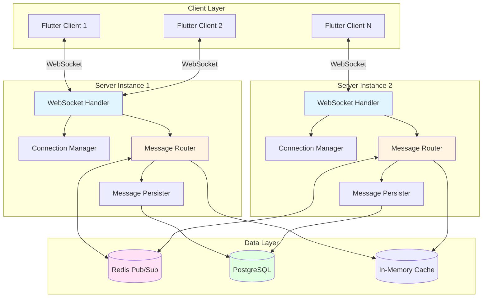
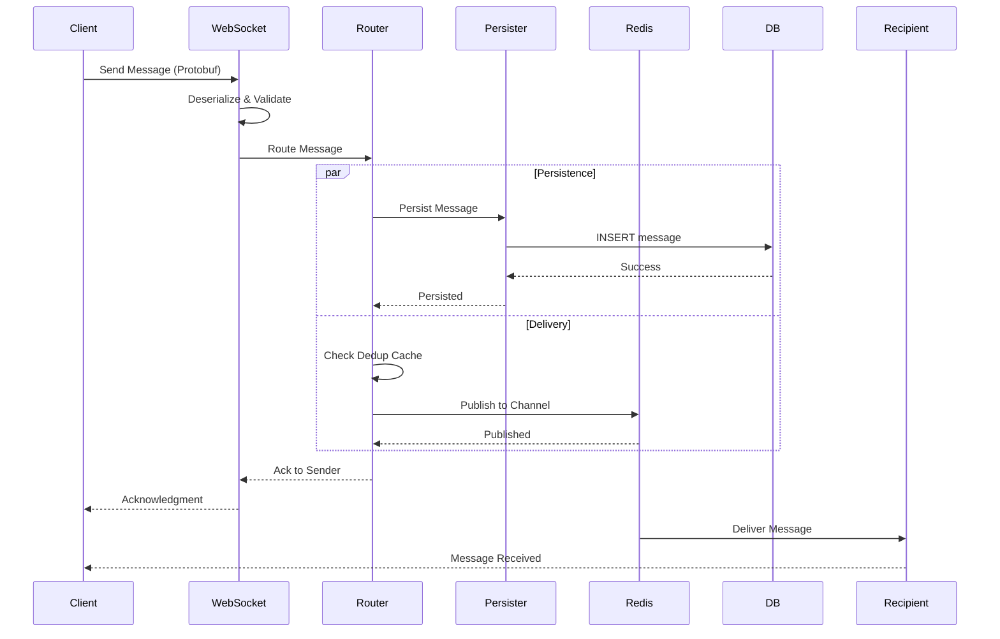

# Design Document: Message System

## Overview

The Message System is the foundational infrastructure of the AI-native instant messaging application. It provides real-time, reliable, and scalable message delivery between users through WebSocket connections, with support for both private and group chats.

The system is designed around a high-performance asynchronous architecture using Rust, Tokio, and Axum. It handles message serialization with Protobuf, persistence with PostgreSQL, and cross-instance routing with Redis Pub/Sub.

Key design principles:
- **Low latency**: Sub-100ms message delivery for real-time experience
- **High reliability**: Guaranteed message persistence and delivery
- **Horizontal scalability**: Support for multiple server instances via Redis
- **Fault tolerance**: Graceful degradation and error isolation
- **Clean architecture**: Modular design with clear separation of concerns

## Architecture

### High-Level Architecture



### Message Flow



## Components and Interfaces

### 1. WebSocket Handler

**Responsibility**: Manage WebSocket connections, handle authentication, and process incoming/outgoing messages

**Interface**:
```rust
#[async_trait]
pub trait WebSocketHandler {
    async fn handle_connection(
        &self,
        socket: WebSocket,
        user_id: String,
    ) -> Result<()>;
    
    async fn send_message(
        &self,
        conn_id: &str,
        message: &ChatMessage,
    ) -> Result<()>;
    
    async fn close_connection(&self, conn_id: &str) -> Result<()>;
}

pub struct AxumWebSocketHandler {
    connection_manager: Arc<ConnectionManager>,
    message_router: Arc<MessageRouter>,
    auth_service: Arc<AuthService>,
}
```

**Implementation Strategy**:
- Accept WebSocket upgrade requests via Axum extractors
- Spawn a Tokio task per connection for bidirectional message handling
- Authenticate user via JWT token in initial handshake
- Deserialize incoming Protobuf messages
- Send heartbeat every 30 seconds, expect pong within 10 seconds
- Handle graceful and ungraceful disconnections

### 2. Connection Manager

**Responsibility**: Track active WebSocket connections and provide connection lookup

**Interface**:
```rust
pub trait ConnectionManager: Send + Sync {
    fn register_connection(
        &self,
        user_id: String,
        conn_id: String,
        sender: mpsc::UnboundedSender<ChatMessage>,
    );
    
    fn unregister_connection(&self, conn_id: &str);
    
    fn get_connection(&self, user_id: &str) -> Option<Vec<String>>;
    
    fn get_sender(&self, conn_id: &str) -> Option<mpsc::UnboundedSender<ChatMessage>>;
    
    fn is_online(&self, user_id: &str) -> bool;
}

pub struct InMemoryConnectionManager {
    // user_id -> Vec<conn_id>
    user_connections: Arc<RwLock<HashMap<String, Vec<String>>>>,
    // conn_id -> message sender
    connection_senders: Arc<RwLock<HashMap<String, mpsc::UnboundedSender<ChatMessage>>>>,
}
```

**Implementation Strategy**:
- Use `RwLock<HashMap>` for thread-safe connection registry
- Support multiple connections per user (multi-device)
- Provide O(1) lookup by user ID and connection ID
- Clean up stale connections on disconnect

### 3. Message Router

**Responsibility**: Route messages to appropriate recipients and handle delivery logic

**Interface**:
```rust
#[async_trait]
pub trait MessageRouter {
    async fn route_message(&self, message: ChatMessage) -> Result<()>;
    
    async fn route_to_user(&self, user_id: &str, message: &ChatMessage) -> Result<()>;
    
    async fn route_to_group(&self, group_id: &str, message: &ChatMessage) -> Result<()>;
}

pub struct RedisMessageRouter {
    connection_manager: Arc<ConnectionManager>,
    redis_client: Arc<RedisClient>,
    persister: Arc<MessagePersister>,
    dedup_cache: Arc<DedupCache>,
}
```

**Implementation Strategy**:
- Check deduplication cache before processing
- Persist message to database (async, don't block routing)
- For private messages: check if recipient is online locally, else publish to Redis
- For group messages: get all group members, publish to Redis channel
- Send acknowledgment back to sender
- Handle offline users by queuing messages

### 4. Message Persister

**Responsibility**: Persist messages to PostgreSQL database

**Interface**:
```rust
#[async_trait]
pub trait MessagePersister {
    async fn persist_message(&self, message: &ChatMessage) -> Result<()>;
    
    async fn get_offline_messages(
        &self,
        user_id: &str,
        since: i64,
    ) -> Result<Vec<ChatMessage>>;
    
    async fn mark_messages_delivered(
        &self,
        message_ids: &[String],
    ) -> Result<()>;
}

pub struct PostgresMessagePersister {
    pool: PgPool,
}
```

**Implementation Strategy**:
- Use SQLx with connection pooling
- Implement retry logic with exponential backoff (3 attempts)
- Batch insert for better performance when possible
- Create indexes on user_id, group_id, timestamp for fast queries
- Use prepared statements for security and performance

**Database Schema**:
```sql
CREATE TABLE messages (
    id UUID PRIMARY KEY,
    sender_id UUID NOT NULL,
    receiver_id UUID,  -- NULL for group messages
    group_id UUID,     -- NULL for private messages
    type SMALLINT NOT NULL,  -- 0=TEXT, 1=IMAGE, 2=VIDEO, 3=EMOJI
    content TEXT NOT NULL,
    timestamp BIGINT NOT NULL,
    is_ai_generated BOOLEAN DEFAULT FALSE,
    delivered BOOLEAN DEFAULT FALSE,
    created_at TIMESTAMP DEFAULT NOW(),
    
    CHECK (
        (receiver_id IS NOT NULL AND group_id IS NULL) OR
        (receiver_id IS NULL AND group_id IS NOT NULL)
    )
);

CREATE INDEX idx_messages_receiver_time ON messages(receiver_id, timestamp DESC) WHERE delivered = FALSE;
CREATE INDEX idx_messages_group_time ON messages(group_id, timestamp DESC);
CREATE INDEX idx_messages_sender_time ON messages(sender_id, timestamp DESC);
CREATE INDEX idx_messages_id ON messages(id);
```

### 5. Redis Client

**Responsibility**: Handle Redis Pub/Sub for cross-instance message routing

**Interface**:
```rust
#[async_trait]
pub trait RedisClient {
    async fn publish(&self, channel: &str, message: &[u8]) -> Result<()>;
    
    async fn subscribe(&self, channels: Vec<String>) -> Result<RedisSubscription>;
    
    async fn unsubscribe(&self, channels: Vec<String>) -> Result<()>;
}

pub struct RedisClientImpl {
    connection_pool: Arc<redis::aio::ConnectionManager>,
}

pub struct RedisSubscription {
    receiver: mpsc::UnboundedReceiver<(String, Vec<u8>)>,
}
```

**Implementation Strategy**:
- Use `redis-rs` async client
- Maintain separate connections for pub and sub (Redis requirement)
- Subscribe to channels: `user:{user_id}` for private messages, `group:{group_id}` for group messages
- Deserialize received messages and deliver to local connections
- Implement reconnection logic with exponential backoff

### 6. Deduplication Cache

**Responsibility**: Prevent duplicate message processing

**Interface**:
```rust
pub trait DedupCache {
    fn check_and_insert(&self, message_id: &str) -> bool;
    
    fn contains(&self, message_id: &str) -> bool;
}

pub struct InMemoryDedupCache {
    cache: Arc<RwLock<HashMap<String, Instant>>>,
    ttl: Duration,
}
```

**Implementation Strategy**:
- Use `HashMap` with timestamp for TTL tracking
- Background task to clean expired entries every minute
- 10-minute TTL for message IDs
- Fallback to database query if cache miss

## Data Models

### Core Data Structures

```rust
// Protobuf definition (from chat.proto)
message ChatMessage {
    string id = 1;
    string sender_id = 2;
    string group_id = 3;
    string receiver_id = 4;
    MsgType type = 5;
    string content = 6;
    int64 timestamp = 7;
    bool is_ai_generated = 8;
}

enum MsgType {
    TEXT = 0;
    IMAGE = 1;
    VIDEO = 2;
    EMOJI = 3;
}

message ClientPacket {
    oneof payload {
        ChatMessage message = 1;
        Heartbeat heartbeat = 2;
        SyncRequest sync = 3;
    }
}

message ServerPacket {
    oneof payload {
        ChatMessage message = 1;
        Acknowledgment ack = 2;
        HeartbeatResponse pong = 3;
    }
}

message Acknowledgment {
    string message_id = 1;
    AckStatus status = 2;
    string error_message = 3;
}

enum AckStatus {
    SUCCESS = 0;
    ERROR = 1;
    DUPLICATE = 2;
}

message Heartbeat {
    int64 timestamp = 1;
}

message HeartbeatResponse {
    int64 timestamp = 1;
}

message SyncRequest {
    int64 since_timestamp = 1;
}
```

### Rust Domain Models

```rust
pub struct Connection {
    pub id: String,
    pub user_id: String,
    pub established_at: Instant,
    pub last_heartbeat: Instant,
}

pub struct OfflineMessage {
    pub message: ChatMessage,
    pub queued_at: i64,
}

pub struct MessageMetrics {
    pub total_messages: u64,
    pub messages_per_second: f64,
    pub avg_latency_ms: f64,
    pub p95_latency_ms: f64,
    pub p99_latency_ms: f64,
    pub error_rate: f64,
}
```


## Correctness Properties

*A property is a characteristic or behavior that should hold true across all valid executions of a system—essentially, a formal statement about what the system should do. Properties serve as the bridge between human-readable specifications and machine-verifiable correctness guarantees.*


### Property Reflection

After analyzing all acceptance criteria, I've identified consolidation opportunities:

**Consolidation Opportunities:**
1. Properties 1.1, 1.3 (connection establishment and registration) can be combined into one property about connection lifecycle
2. Properties 3.2 and 3.3 (persistence completeness and flow continuation) are related aspects of the same operation
3. Properties 6.1, 6.2, 6.5 (acknowledgment sending, content, and format) can be combined into one comprehensive ack property
4. Properties 9.1, 9.3, 9.4, 9.5 (duplicate detection flow) can be combined into one property about deduplication
5. Properties 10.2 and 10.3 (disconnection cleanup) can be combined

**Redundancy Elimination:**
- Properties 12.1-12.5 are architectural guidelines, not runtime properties
- Property 2.3 (routing timing) is subsumed by Property 5.3 (overall latency under load)

After reflection, we'll focus on unique, high-value properties.

### Correctness Properties

Property 1: Unique connection identifiers
*For any* WebSocket connection establishment, the assigned connection identifier should be unique across all active connections
**Validates: Requirements 1.1**

Property 2: Authentication timing constraint
*For any* WebSocket connection, user authentication should complete within 3 seconds
**Validates: Requirements 1.2**

Property 3: Connection registration on auth success
*For any* successful authentication, the connection should appear in the active connections registry
**Validates: Requirements 1.3**

Property 4: Connection closure on auth failure
*For any* failed authentication attempt, the WebSocket connection should be closed with a descriptive error code
**Validates: Requirements 1.4**

Property 5: Heartbeat timing
*For any* WebSocket connection idle for more than 60 seconds, a heartbeat message should be sent
**Validates: Requirements 1.5**

Property 6: Deserialization performance
*For any* incoming message, Protobuf deserialization should complete within 10 milliseconds
**Validates: Requirements 2.1**

Property 7: Message validation completeness
*For any* deserialized message, validation should verify the presence of all required fields: message ID, sender ID, and content
**Validates: Requirements 2.2**

Property 8: Private message delivery to online users
*For any* private chat message where the receiver is online, the message should be delivered to the receiver's active WebSocket connection
**Validates: Requirements 2.4**

Property 9: Group message fanout
*For any* group chat message, the message should be delivered to all active group members' WebSocket connections
**Validates: Requirements 2.5**

Property 10: Message persistence timing
*For any* received message, persistence to PostgreSQL should complete within 200 milliseconds
**Validates: Requirements 3.1**

Property 11: Persistence data completeness
*For any* persisted message, all fields (ID, sender ID, receiver ID or group ID, type, content, timestamp) should be stored in the database
**Validates: Requirements 3.2**

Property 12: Persistence retry logic
*For any* database persistence failure, the system should retry up to 3 times with exponential backoff before giving up
**Validates: Requirements 3.4**

Property 13: Persistence final failure handling
*For any* message where all 3 persistence retry attempts fail, an error response should be sent to the sender and the error should be logged
**Validates: Requirements 3.5**

Property 14: Offline message queuing
*For any* message sent to an offline user, the message should be stored in the offline messages queue for that user
**Validates: Requirements 4.1**

Property 15: Offline message retrieval on connection
*For any* user establishing a WebSocket connection, all offline messages for that user should be retrieved from the database
**Validates: Requirements 4.2**

Property 16: Offline message chronological ordering
*For any* set of offline messages delivered to a user, they should be ordered chronologically by timestamp
**Validates: Requirements 4.3**

Property 17: Offline message delivery status update
*For any* successfully delivered offline message, the delivered flag should be set to true in the database
**Validates: Requirements 4.4**

Property 18: Offline message batching
*For any* user with more than 1000 offline messages, messages should be delivered in batches of 100 with 500ms delay between batches
**Validates: Requirements 4.5**

Property 19: Concurrent message task spawning
*For any* set of messages arriving simultaneously, each message should be processed in a separate Tokio task
**Validates: Requirements 5.1**

Property 20: Conversation thread ordering
*For any* set of concurrent messages in the same conversation thread, message ordering should be preserved based on timestamp
**Validates: Requirements 5.2**

Property 21: High throughput latency constraint
*For any* system load of 1000+ messages per second, average message delivery latency should remain below 100 milliseconds
**Validates: Requirements 5.3**

Property 22: Backpressure on pool exhaustion
*For any* scenario where the database connection pool is exhausted, incoming messages should be queued and backpressure should be applied
**Validates: Requirements 5.4**

Property 23: Connection failure isolation
*For any* single WebSocket connection failure, other active connections should continue processing messages without errors
**Validates: Requirements 5.5**

Property 24: Acknowledgment on successful persistence
*For any* message successfully persisted to the database, an acknowledgment containing the message ID and success status should be sent to the sender in Protobuf format
**Validates: Requirements 6.1, 6.2, 6.5**

Property 25: Error acknowledgment on delivery failure
*For any* message delivery failure, an error acknowledgment with a descriptive error code should be sent to the sender
**Validates: Requirements 6.3**

Property 26: Delivery receipt to sender
*For any* message successfully delivered to a recipient, a delivery receipt should be sent to the sender
**Validates: Requirements 6.4**

Property 27: Redis Pub/Sub for multi-instance routing
*For any* multi-instance deployment, messages should be routed through Redis Pub/Sub channels
**Validates: Requirements 7.1**

Property 28: Redis channel publishing
*For any* message received on a server instance, the message should be published to the appropriate Redis channel (user:{user_id} for private, group:{group_id} for group messages)
**Validates: Requirements 7.2**

Property 29: Redis subscription management
*For any* server instance, Redis subscriptions should include channels for all connected users and groups
**Validates: Requirements 7.3**

Property 30: Dynamic subscription updates
*For any* user connecting to a different server instance, Redis subscriptions should be automatically updated
**Validates: Requirements 7.4**

Property 31: Redis fallback to database polling
*For any* scenario where Redis Pub/Sub is unavailable, the system should fall back to database polling with 1-second intervals
**Validates: Requirements 7.5**

Property 32: Message type support
*For any* message, the system should accept and process message types: TEXT, IMAGE, VIDEO, and EMOJI
**Validates: Requirements 8.1**

Property 33: Text message length validation
*For any* TEXT message, the content length should not exceed 10000 characters, and messages exceeding this should be rejected
**Validates: Requirements 8.2**

Property 34: Media message URL validation
*For any* IMAGE or VIDEO message, the content field should contain a valid URL, and invalid URLs should be rejected
**Validates: Requirements 8.3**

Property 35: Emoji message validation
*For any* EMOJI message, the content field should contain a valid emoji identifier, and invalid identifiers should be rejected
**Validates: Requirements 8.4**

Property 36: Validation error rejection
*For any* message failing type validation, the message should be rejected with a descriptive error code
**Validates: Requirements 8.5**

Property 37: Deduplication check and cache usage
*For any* received message, the system should check for duplicate message IDs using the in-memory cache (10-minute TTL) first, then the database on cache miss, and add unique messages to the cache
**Validates: Requirements 9.1, 9.3, 9.4, 9.5**

Property 38: Duplicate message handling
*For any* message with a duplicate ID, the message should be discarded and a duplicate acknowledgment should be sent to the sender
**Validates: Requirements 9.2**

Property 39: Disconnection detection timing
*For any* unexpectedly closed WebSocket connection, disconnection should be detected within 5 seconds
**Validates: Requirements 10.1**

Property 40: Disconnection cleanup
*For any* detected disconnection, the connection should be removed from the active connections registry and all Redis channels should be unsubscribed
**Validates: Requirements 10.2, 10.3**

Property 41: Reconnection authentication
*For any* user reconnecting after disconnection, full authentication should be performed as if it were a new connection
**Validates: Requirements 10.4**

Property 42: Offline message delivery on reconnect
*For any* user reconnecting, all messages sent during the disconnection period should be delivered as offline messages
**Validates: Requirements 10.5**

Property 43: Message processing logging
*For any* processed message, a log entry should include message ID, sender ID, recipient ID, type, and processing time
**Validates: Requirements 11.1**

Property 44: Error logging completeness
*For any* error occurrence, the log should include full context with stack trace and relevant message data
**Validates: Requirements 11.2**

Property 45: Metrics tracking
*For any* message processing, metrics should be tracked including throughput, latency percentiles (p50, p95, p99), and error rates
**Validates: Requirements 11.3**

Property 46: Connection event logging
*For any* WebSocket connection establishment or closure, a log entry should include user ID and timestamp
**Validates: Requirements 11.4**

Property 47: Prometheus metrics exposure
*For any* metrics collection, metrics should be exposed through a Prometheus-compatible endpoint in valid format
**Validates: Requirements 11.5**


## Error Handling

### Error Categories

The Message System defines four categories of errors with distinct handling strategies:

#### 1. Transient Errors (Retry-able)
- **Database connection failures**: Retry with exponential backoff (100ms, 500ms, 2s)
- **Redis connection failures**: Retry connection, fallback to database polling if persistent
- **Network timeouts**: Retry operation up to 3 times

#### 2. Permanent Errors (Non-retry-able)
- **Invalid protobuf data**: Log error, send error ack to sender, discard message
- **Authentication failures**: Close connection with error code
- **Message validation failures**: Send error ack, don't persist or route

#### 3. Degraded Mode Errors
- **Redis unavailable**: Fall back to database polling for message routing
- **Database read failures**: Return cached data if available, else return error
- **Connection pool exhausted**: Queue messages, apply backpressure

#### 4. Critical Errors (System-level)
- **Database pool completely unavailable**: Stop accepting new messages, alert operators
- **Memory exhaustion**: Reject new connections, log critical alert
- **Tokio runtime panic**: Isolate to single task, don't crash entire system

### Error Handling Patterns

```rust
// Retry with exponential backoff for database operations
async fn persist_with_retry(&self, message: &ChatMessage) -> Result<()> {
    let mut attempts = 0;
    let backoff_ms = [100, 500, 2000];
    
    loop {
        match self.db.insert_message(message).await {
            Ok(_) => return Ok(()),
            Err(e) if attempts < 3 => {
                warn!("DB persist failed (attempt {}): {}", attempts + 1, e);
                tokio::time::sleep(Duration::from_millis(backoff_ms[attempts])).await;
                attempts += 1;
            }
            Err(e) => {
                error!("DB persist failed after {} attempts", attempts);
                return Err(e);
            }
        }
    }
}

// Graceful degradation for Redis failures
async fn route_message(&self, message: ChatMessage) -> Result<()> {
    match self.redis.publish(&channel, &data).await {
        Ok(_) => Ok(()),
        Err(e) => {
            warn!("Redis unavailable, falling back to database polling: {}", e);
            self.fallback_to_db_polling().await
        }
    }
}

// Error isolation for WebSocket connections
async fn handle_connection(&self, socket: WebSocket, user_id: String) {
    let result = tokio::spawn(async move {
        // Connection handling logic that might fail
        self.process_connection(socket, user_id).await
    }).await;
    
    if let Err(e) = result {
        error!("Connection task panicked for user {}: {:?}", user_id, e);
        // Task is isolated, other connections continue normally
    }
}
```

### Logging Strategy

- **Debug**: Message routing decisions, cache hits/misses, subscription updates
- **Info**: Connection established/closed, messages sent/received, offline message sync
- **Warn**: Retry attempts, degraded mode activation, validation failures
- **Error**: All retry attempts exhausted, persistence failures, routing errors
- **Critical**: System-level issues (pool exhausted, Redis completely down)

## Testing Strategy

The Message System requires comprehensive testing combining unit tests, property-based tests, and integration tests.

### Unit Testing

Unit tests verify specific behaviors and edge cases:

**WebSocket Handler Tests**:
- Test connection establishment with valid/invalid auth tokens
- Test heartbeat sending after 60 seconds of idle time
- Test graceful connection closure
- Test message deserialization with malformed protobuf

**Connection Manager Tests**:
- Test connection registration and lookup
- Test multi-device support (multiple connections per user)
- Test connection cleanup on disconnect
- Test thread-safe concurrent access

**Message Router Tests**:
- Test private message routing to online/offline users
- Test group message fanout to all members
- Test deduplication cache hit/miss scenarios
- Test Redis channel selection logic

**Message Persister Tests**:
- Test message insertion with all field types
- Test offline message retrieval with pagination
- Test delivery status updates
- Test retry logic with mock database failures

**Redis Client Tests**:
- Test pub/sub with multiple channels
- Test subscription management
- Test reconnection logic
- Test fallback to database polling

### Property-Based Testing

Property-based tests verify universal properties across all inputs.

**Framework**: Use `proptest` crate for Rust property-based testing

**Configuration**: Each property test should run a minimum of 100 iterations

**Tagging Convention**: Each property test must include a comment with this exact format:
```rust
// **Feature: message-system, Property {number}: {property_text}**
```

**Key Property Tests**:

1. **Unique Connection IDs** (Property 1)
   - Generate N concurrent connection requests
   - Verify all assigned IDs are unique

2. **Authentication Timing** (Property 2)
   - Generate random auth tokens (valid/invalid)
   - Verify auth completes within 3 seconds

3. **Deserialization Performance** (Property 6)
   - Generate random protobuf messages (varying sizes)
   - Verify deserialization < 10ms for all

4. **Message Validation** (Property 7)
   - Generate messages with missing/invalid fields
   - Verify validation catches all issues

5. **Persistence Timing** (Property 10)
   - Generate random messages
   - Verify persistence < 200ms for all

6. **Offline Message Ordering** (Property 16)
   - Generate random offline messages with timestamps
   - Verify delivery order matches timestamp order

7. **Deduplication** (Property 37)
   - Generate messages with duplicate IDs
   - Verify duplicates are detected and discarded

8. **Protobuf Round-Trip** (Combined with Property 24)
   - Generate random ChatMessage instances
   - Verify serialize → deserialize produces equivalent message

**Generator Strategies**:

```rust
// Generate realistic chat messages
prop_compose! {
    fn arb_chat_message()(
        id in "[a-f0-9]{32}",
        sender_id in "[a-f0-9]{32}",
        receiver_id in prop::option::of("[a-f0-9]{32}"),
        group_id in prop::option::of("[a-f0-9]{32}"),
        msg_type in 0i32..=3i32,
        content in "\\PC{1,500}",
        timestamp in 1600000000i64..1700000000i64,
    ) -> ChatMessage {
        ChatMessage {
            id, sender_id,
            receiver_id: receiver_id.unwrap_or_default(),
            group_id: group_id.unwrap_or_default(),
            r#type: msg_type,
            content,
            timestamp,
            is_ai_generated: false,
        }
    }
}

// Generate connection scenarios
prop_compose! {
    fn arb_connection_scenario()(
        num_users in 1usize..=100,
        num_messages in 10usize..=1000,
        offline_probability in 0.0f64..=0.5,
    ) -> ConnectionScenario {
        ConnectionScenario {
            num_users,
            num_messages,
            offline_probability,
        }
    }
}
```

### Integration Testing

Integration tests verify end-to-end flows with real dependencies:

1. **Full Message Flow**:
   - Start WebSocket server, PostgreSQL, Redis
   - Connect client, send message
   - Verify message persisted, routed, and delivered
   - Verify acknowledgment received

2. **Offline Message Sync**:
   - Send messages to offline user
   - Connect user
   - Verify all offline messages delivered in order
   - Verify delivery status updated

3. **Multi-Instance Routing**:
   - Start 2 server instances with Redis
   - Connect users to different instances
   - Send messages between users
   - Verify cross-instance routing works

4. **Graceful Degradation**:
   - Start system with Redis
   - Stop Redis mid-operation
   - Verify fallback to database polling
   - Verify messages still delivered

### Performance Testing

Performance tests verify timing constraints and scalability:

1. **Latency Under Load**: Send 1000 msg/sec, measure p50/p95/p99 latency (target: p99 < 100ms)
2. **Connection Scalability**: Establish 10,000 concurrent connections, verify system stability
3. **Offline Message Batching**: Create 5000 offline messages, verify batching works correctly
4. **Database Connection Pool**: Exhaust pool, verify backpressure and recovery

### Test Data Management

- **Fixtures**: Pre-generated users, groups, message templates
- **Factories**: Builder pattern for creating test entities
- **Cleanup**: Each test should clean up database records and Redis keys
- **Isolation**: Use separate database schemas per test to avoid interference

