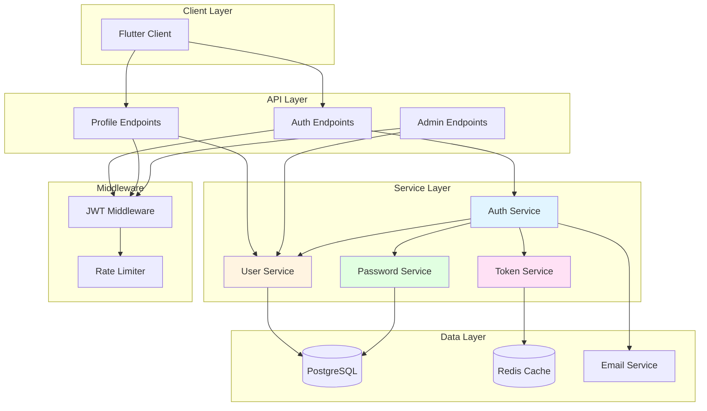
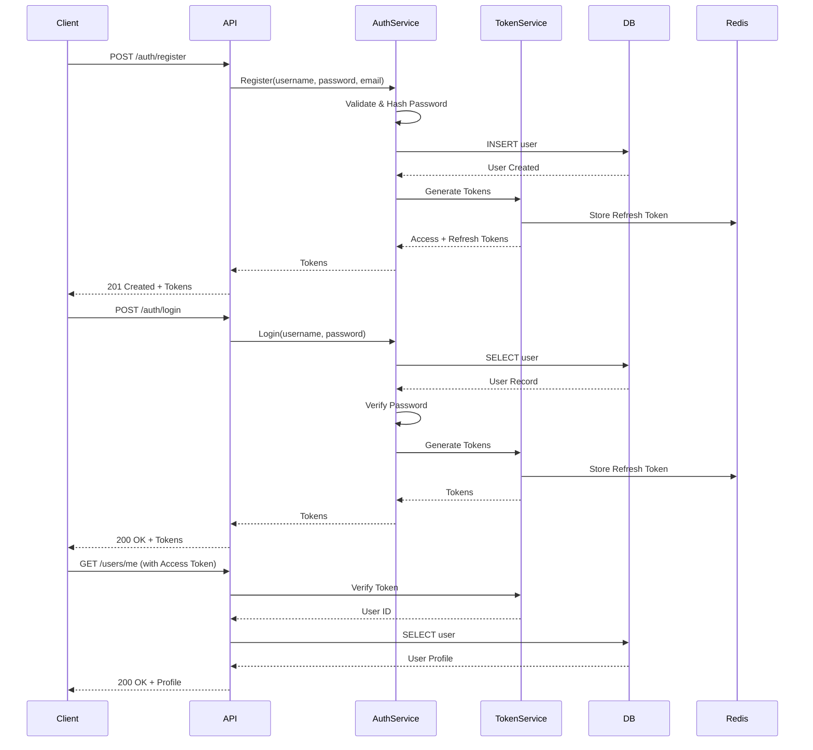

# Design Document: User Authentication & Management System

## Overview

The User Authentication & Management System provides secure identity verification, session management, and user profile management for the AI-native instant messaging application. It implements JWT-based authentication with refresh token rotation, password security best practices, and comprehensive user management features.

The system is designed with security as the top priority while maintaining a simple and frictionless user experience aligned with the application's minimalist philosophy.

Key design principles:
- **Security-first**: Industry-standard encryption, secure token management, rate limiting
- **Stateless authentication**: JWT tokens for scalability across multiple server instances
- **User privacy**: Minimal data collection, secure password storage, data anonymization
- **Performance**: Efficient database queries, token caching, batch operations
- **Auditability**: Comprehensive security event logging for compliance

## Architecture

### High-Level Architecture



### Authentication Flow



## Components and Interfaces

### 1. Auth Service

**Responsibility**: Handle user registration, login, logout, and password management

**Interface**:
```rust
#[async_trait]
pub trait AuthService {
    async fn register(
        &self,
        username: String,
        password: String,
        email: String,
    ) -> Result<AuthResponse>;
    
    async fn login(
        &self,
        username: String,
        password: String,
    ) -> Result<AuthResponse>;
    
    async fn logout(&self, refresh_token: String) -> Result<()>;
    
    async fn change_password(
        &self,
        user_id: Uuid,
        current_password: String,
        new_password: String,
    ) -> Result<()>;
    
    async fn request_password_reset(&self, email: String) -> Result<()>;
    
    async fn reset_password(
        &self,
        reset_token: String,
        new_password: String,
    ) -> Result<()>;
}

pub struct AuthResponse {
    pub user: UserProfile,
    pub access_token: String,
    pub refresh_token: String,
}
```

**Implementation Strategy**:
- Validate input using regex patterns
- Hash passwords with bcrypt (cost factor 12)
- Generate JWT tokens via TokenService
- Track failed login attempts in Redis
- Implement account lockout (5 failures = 15 min lock)
- Send password reset emails via email service
- Log all security events

### 2. User Service

**Responsibility**: Manage user profiles, search, and status updates

**Interface**:
```rust
#[async_trait]
pub trait UserService {
    async fn get_user_by_id(&self, user_id: Uuid) -> Result<UserProfile>;
    
    async fn get_users_by_ids(&self, user_ids: Vec<Uuid>) -> Result<Vec<UserProfile>>;
    
    async fn update_profile(
        &self,
        user_id: Uuid,
        updates: ProfileUpdate,
    ) -> Result<UserProfile>;
    
    async fn search_users(&self, query: String, limit: usize) -> Result<Vec<UserProfile>>;
    
    async fn set_online_status(
        &self,
        user_id: Uuid,
        online: bool,
    ) -> Result<()>;
    
    async fn update_last_seen(&self, user_id: Uuid) -> Result<()>;
    
    async fn suspend_account(&self, user_id: Uuid) -> Result<()>;
    
    async fn delete_account(&self, user_id: Uuid) -> Result<()>;
}

pub struct UserProfile {
    pub id: Uuid,
    pub username: String,
    pub avatar: Option<String>,
    pub bio: Option<String>,
    pub online: bool,
    pub last_seen: Option<i64>,
    pub created_at: i64,
}

pub struct ProfileUpdate {
    pub username: Option<String>,
    pub avatar: Option<String>,
    pub bio: Option<String>,
}
```

**Implementation Strategy**:
- Use SQLx for database operations with connection pooling
- Implement efficient batch queries for multiple users
- Use database indexes on username and user_id
- Publish online status changes to Redis for real-time updates
- Anonymize data on account deletion (GDPR compliance)
- Cache frequently accessed profiles in Redis

### 3. Token Service

**Responsibility**: Generate, verify, and manage JWT tokens

**Interface**:
```rust
#[async_trait]
pub trait TokenService {
    fn generate_access_token(&self, user_id: Uuid, username: &str) -> Result<String>;
    
    fn generate_refresh_token(&self, user_id: Uuid) -> Result<String>;
    
    fn verify_access_token(&self, token: &str) -> Result<TokenClaims>;
    
    fn verify_refresh_token(&self, token: &str) -> Result<TokenClaims>;
    
    async fn store_refresh_token(
        &self,
        user_id: Uuid,
        token: &str,
        expires_at: i64,
    ) -> Result<()>;
    
    async fn invalidate_refresh_token(&self, token: &str) -> Result<()>;
    
    async fn invalidate_all_user_tokens(&self, user_id: Uuid) -> Result<()>;
    
    async fn is_token_blacklisted(&self, token: &str) -> Result<bool>;
}

pub struct TokenClaims {
    pub user_id: Uuid,
    pub username: String,
    pub exp: i64,
    pub iat: i64,
}
```

**Implementation Strategy**:
- Use `jsonwebtoken` crate for JWT operations
- Access tokens: 15 minutes validity
- Refresh tokens: 7 days validity
- Store refresh tokens in Redis with TTL
- Implement token blacklist in Redis for logout
- Use HS256 algorithm with secret key from environment
- Include user_id, username, exp, iat in claims

**Token Structure**:
```rust
// Access Token Claims
{
    "user_id": "uuid",
    "username": "string",
    "exp": 1234567890,  // 15 minutes from now
    "iat": 1234567890,
    "type": "access"
}

// Refresh Token Claims
{
    "user_id": "uuid",
    "exp": 1234567890,  // 7 days from now
    "iat": 1234567890,
    "type": "refresh"
}
```

### 4. Password Service

**Responsibility**: Handle password hashing, verification, and validation

**Interface**:
```rust
pub trait PasswordService {
    fn hash_password(&self, password: &str) -> Result<String>;
    
    fn verify_password(&self, password: &str, hash: &str) -> Result<bool>;
    
    fn validate_password_strength(&self, password: &str) -> Result<()>;
    
    fn generate_reset_token(&self) -> String;
}
```

**Implementation Strategy**:
- Use `bcrypt` crate with cost factor 12
- Validate password: min 8 chars, 1 uppercase, 1 lowercase, 1 number
- Generate secure random reset tokens (32 bytes, hex encoded)
- Store reset tokens in database with 1-hour expiration

### 5. JWT Middleware

**Responsibility**: Authenticate API requests using JWT tokens

**Interface**:
```rust
pub async fn jwt_middleware(
    req: Request<Body>,
    next: Next<Body>,
) -> Result<Response, StatusCode>;

pub struct AuthenticatedUser {
    pub user_id: Uuid,
    pub username: String,
}
```

**Implementation Strategy**:
- Extract token from Authorization header (Bearer scheme)
- Verify token using TokenService
- Check token blacklist
- Attach user info to request extensions
- Return 401 for invalid/missing tokens

### 6. Rate Limiter

**Responsibility**: Prevent abuse and brute force attacks

**Interface**:
```rust
#[async_trait]
pub trait RateLimiter {
    async fn check_rate_limit(
        &self,
        key: &str,
        max_requests: u32,
        window_seconds: u64,
    ) -> Result<bool>;
    
    async fn record_failed_login(&self, username: &str) -> Result<u32>;
    
    async fn is_account_locked(&self, username: &str) -> Result<bool>;
    
    async fn reset_failed_attempts(&self, username: &str) -> Result<()>;
}
```

**Implementation Strategy**:
- Use Redis for rate limit counters with TTL
- Track failed logins per username
- Lock account after 5 failures for 15 minutes
- Use sliding window algorithm for rate limiting
- Different limits for different endpoints

## Data Models

### Database Schema

```sql
-- Users table
CREATE TABLE users (
    id UUID PRIMARY KEY DEFAULT gen_random_uuid(),
    username VARCHAR(30) UNIQUE NOT NULL,
    email VARCHAR(255) UNIQUE NOT NULL,
    password_hash VARCHAR(255) NOT NULL,
    avatar TEXT,
    bio VARCHAR(500),
    online BOOLEAN DEFAULT FALSE,
    last_seen BIGINT,
    account_status VARCHAR(20) DEFAULT 'active',  -- active, suspended, deleted
    created_at TIMESTAMP DEFAULT NOW(),
    updated_at TIMESTAMP DEFAULT NOW(),
    
    CHECK (char_length(username) >= 3),
    CHECK (account_status IN ('active', 'suspended', 'deleted'))
);

CREATE INDEX idx_users_username ON users(username);
CREATE INDEX idx_users_email ON users(email);
CREATE INDEX idx_users_status ON users(account_status) WHERE account_status != 'deleted';

-- Password reset tokens
CREATE TABLE password_reset_tokens (
    id UUID PRIMARY KEY DEFAULT gen_random_uuid(),
    user_id UUID NOT NULL REFERENCES users(id),
    token VARCHAR(64) UNIQUE NOT NULL,
    used BOOLEAN DEFAULT FALSE,
    expires_at TIMESTAMP NOT NULL,
    created_at TIMESTAMP DEFAULT NOW()
);

CREATE INDEX idx_reset_tokens_token ON password_reset_tokens(token) WHERE used = FALSE;
CREATE INDEX idx_reset_tokens_expiry ON password_reset_tokens(expires_at) WHERE used = FALSE;

-- Security audit log
CREATE TABLE security_audit_log (
    id BIGSERIAL PRIMARY KEY,
    user_id UUID REFERENCES users(id),
    username VARCHAR(30),
    event_type VARCHAR(50) NOT NULL,  -- login_success, login_failure, password_change, etc.
    ip_address INET,
    user_agent TEXT,
    metadata JSONB,
    created_at TIMESTAMP DEFAULT NOW()
);

CREATE INDEX idx_audit_log_user ON security_audit_log(user_id, created_at DESC);
CREATE INDEX idx_audit_log_event ON security_audit_log(event_type, created_at DESC);
CREATE INDEX idx_audit_log_time ON security_audit_log(created_at DESC);
```

### Rust Domain Models

```rust
#[derive(Debug, Clone, Serialize, Deserialize)]
pub struct User {
    pub id: Uuid,
    pub username: String,
    pub email: String,
    pub password_hash: String,
    pub avatar: Option<String>,
    pub bio: Option<String>,
    pub online: bool,
    pub last_seen: Option<i64>,
    pub account_status: AccountStatus,
    pub created_at: i64,
    pub updated_at: i64,
}

#[derive(Debug, Clone, Serialize, Deserialize)]
pub enum AccountStatus {
    Active,
    Suspended,
    Deleted,
}

#[derive(Debug, Clone)]
pub struct PasswordResetToken {
    pub id: Uuid,
    pub user_id: Uuid,
    pub token: String,
    pub used: bool,
    pub expires_at: i64,
    pub created_at: i64,
}

#[derive(Debug, Clone, Serialize)]
pub struct SecurityAuditLog {
    pub id: i64,
    pub user_id: Option<Uuid>,
    pub username: Option<String>,
    pub event_type: String,
    pub ip_address: Option<String>,
    pub user_agent: Option<String>,
    pub metadata: serde_json::Value,
    pub created_at: i64,
}
```

### Redis Data Structures

```rust
// Refresh tokens: key = "refresh_token:{token}", value = user_id, TTL = 7 days
// Token blacklist: key = "blacklist:{token}", value = "1", TTL = token expiry
// Failed login attempts: key = "failed_login:{username}", value = count, TTL = 15 minutes
// Account lockout: key = "locked:{username}", value = "1", TTL = 15 minutes
// Rate limit: key = "rate_limit:{endpoint}:{user_id}", value = count, TTL = window duration
// User profile cache: key = "user_profile:{user_id}", value = JSON, TTL = 5 minutes
```


## Correctness Properties

*A property is a characteristic or behavior that should hold true across all valid executions of a system—essentially, a formal statement about what the system should do. Properties serve as the bridge between human-readable specifications and machine-verifiable correctness guarantees.*


### Property Reflection

After analyzing all acceptance criteria, I've identified consolidation opportunities:

**Consolidation Opportunities:**
1. Properties 1.3 and 5.3 (password hashing on registration and change) can be combined into one property about password hashing
2. Properties 2.3 and 3.3 (token generation with specific validity) are related and can reference a common token validity property
3. Properties 5.4 and 6.5 (token invalidation on password change/reset) can be combined
4. Properties 7.1, 7.2, 7.3, 7.4, 7.5 (failed login tracking and lockout) can be combined into comprehensive lockout properties
5. Properties 10.5 and 11.5 are implementation details, not behavioral properties

**Redundancy Elimination:**
- Properties about implementation details (database indexes) are not runtime testable
- Property 3.5 (optional token rotation) is a configuration option, not a strict requirement

After reflection, we'll focus on unique, high-value properties.

### Correctness Properties

Property 1: Username validation on registration
*For any* registration request, the username should be validated to be unique and between 3 and 30 characters in length
**Validates: Requirements 1.1**

Property 2: Password complexity validation
*For any* password (registration or change), the password should be at least 8 characters and contain at least one uppercase letter, one lowercase letter, and one number
**Validates: Requirements 1.2, 5.2**

Property 3: Password hashing with bcrypt
*For any* password storage operation (registration or change), the password should be hashed using bcrypt with cost factor 12
**Validates: Requirements 1.3, 5.3**

Property 4: User creation with unique UUID
*For any* successful registration, a user record should be created in the database with a unique UUID
**Validates: Requirements 1.4**

Property 5: Token pair generation on registration
*For any* successful registration, both an access token and a refresh token should be generated and returned to the client
**Validates: Requirements 1.5**

Property 6: User retrieval by username on login
*For any* login attempt, the system should retrieve the user record by username from the database
**Validates: Requirements 2.1**

Property 7: Password verification with bcrypt
*For any* login attempt with a found user, the provided password should be verified against the stored hash using bcrypt
**Validates: Requirements 2.2**

Property 8: Token validity periods
*For any* successful authentication, the access token should be valid for 15 minutes and the refresh token should be valid for 7 days
**Validates: Requirements 2.3, 3.3**

Property 9: JWT payload completeness
*For any* generated JWT token, the payload should include user ID, username, and token expiration
**Validates: Requirements 2.4**

Property 10: Login error message security
*For any* failed login attempt, the error message should not reveal whether the username or password was incorrect
**Validates: Requirements 2.5**

Property 11: Token refresh functionality
*For any* expired access token with a valid refresh token, a new access token should be generated
**Validates: Requirements 3.1**

Property 12: Refresh token validation
*For any* refresh token usage, the token signature and expiration should be verified
**Validates: Requirements 3.2**

Property 13: Refresh token rejection on expiry
*For any* expired or invalid refresh token, the request should be rejected and require full re-authentication
**Validates: Requirements 3.4**

Property 14: Profile update field support
*For any* profile update request, the system should allow modification of username, avatar URL, and bio
**Validates: Requirements 4.1**

Property 15: Username uniqueness on update
*For any* username update, the system should validate uniqueness and length constraints (3-30 characters)
**Validates: Requirements 4.2**

Property 16: Avatar URL validation
*For any* avatar update, the system should validate that the avatar field contains a valid URL or is empty
**Validates: Requirements 4.3**

Property 17: Bio length validation
*For any* bio update, the system should validate that the bio does not exceed 500 characters
**Validates: Requirements 4.4**

Property 18: Profile update response
*For any* successful profile update, the updated user profile should be returned to the client
**Validates: Requirements 4.5**

Property 19: Current password requirement for change
*For any* password change request, the current password should be required and verified
**Validates: Requirements 5.1**

Property 20: Token invalidation on password change
*For any* successful password change or reset, all existing refresh tokens for that user should be invalidated
**Validates: Requirements 5.4, 6.5**

Property 21: Email notification on password change
*For any* successful password change, a notification email should be sent to the user's registered email address
**Validates: Requirements 5.5**

Property 22: Reset token generation
*For any* password reset request, a unique reset token valid for 1 hour should be generated
**Validates: Requirements 6.1**

Property 23: Reset email sending
*For any* password reset request, an email with the reset link should be sent to the user's registered email address
**Validates: Requirements 6.2**

Property 24: Reset token validation
*For any* password reset submission, the token should be validated to ensure it is not expired and has not been used
**Validates: Requirements 6.3**

Property 25: Password update and token invalidation on reset
*For any* valid reset token, the password should be updated and the reset token should be marked as used
**Validates: Requirements 6.4**

Property 26: Failed login attempt tracking
*For any* failed login attempt, the system should increment the failed attempt counter for that username
**Validates: Requirements 7.1**

Property 27: Account lockout after failed attempts
*For any* username with more than 5 failed login attempts within 15 minutes, the account should be locked for 15 minutes
**Validates: Requirements 7.2**

Property 28: Login rejection during lockout
*For any* login attempt on a locked account, the request should be rejected with a descriptive error message
**Validates: Requirements 7.3**

Property 29: Automatic account unlock
*For any* locked account, the account should automatically unlock and the failed attempt counter should reset after 15 minutes
**Validates: Requirements 7.4**

Property 30: Failed attempt counter reset on success
*For any* successful login, the failed attempt counter for that user should be reset to zero
**Validates: Requirements 7.5**

Property 31: Online status on connection
*For any* WebSocket connection establishment, the user's online status should be set to true
**Validates: Requirements 8.1**

Property 32: Offline status on disconnection
*For any* WebSocket connection closure, the user's online status should be set to false and the last seen timestamp should be recorded
**Validates: Requirements 8.2**

Property 33: Status change publication
*For any* user online status change, the status update should be published to Redis for real-time notification
**Validates: Requirements 8.3**

Property 34: Profile includes online status
*For any* user profile query, the response should include the online status and last seen timestamp
**Validates: Requirements 8.4**

Property 35: Away status on inactivity
*For any* user inactive for more than 5 minutes, the user should be marked as away while keeping the connection active
**Validates: Requirements 8.5**

Property 36: Token signature verification
*For any* API request with an access token, the token signature should be verified using the secret key
**Validates: Requirements 9.1**

Property 37: Token expiration check
*For any* token verification, the system should check that the token has not expired
**Validates: Requirements 9.2**

Property 38: Token claims extraction
*For any* valid token, the user ID and username should be extracted from the payload
**Validates: Requirements 9.3**

Property 39: Unauthorized status on invalid token
*For any* invalid or expired token, the request should be rejected with a 401 Unauthorized status
**Validates: Requirements 9.4**

Property 40: User context attachment
*For any* successful token verification, the user information should be attached to the request context for downstream handlers
**Validates: Requirements 9.5**

Property 41: Public profile retrieval
*For any* user profile request, the response should include username, avatar, bio, and online status
**Validates: Requirements 10.1**

Property 42: Sensitive data exclusion
*For any* profile retrieval, sensitive information (email, password hash, refresh tokens) should not be exposed
**Validates: Requirements 10.2**

Property 43: Not found error for non-existent users
*For any* profile request for a non-existent user, the system should return a 404 Not Found error
**Validates: Requirements 10.3**

Property 44: Batch profile retrieval limit
*For any* batch profile retrieval request, the system should support a maximum of 100 users per request
**Validates: Requirements 10.4**

Property 45: Case-insensitive username search
*For any* username search query, the system should return matching users using case-insensitive partial matching
**Validates: Requirements 11.1**

Property 46: Search result limit
*For any* search query, the results should be limited to 20 users maximum
**Validates: Requirements 11.2**

Property 47: Search result completeness
*For any* search result, each user should include username, avatar, and online status
**Validates: Requirements 11.3**

Property 48: Search query minimum length
*For any* search query less than 2 characters, the request should be rejected with a validation error
**Validates: Requirements 11.4**

Property 49: Refresh token invalidation on logout
*For any* logout request, the current refresh token should be invalidated
**Validates: Requirements 12.1**

Property 50: Token blacklist with TTL
*For any* invalidated refresh token, it should be added to a blacklist with expiration matching the token's original expiry
**Validates: Requirements 12.2**

Property 51: Blacklisted token rejection
*For any* blacklisted token usage attempt, the request should be rejected with an error
**Validates: Requirements 12.3**

Property 52: Logout success response
*For any* successful logout, a success response should be returned to the client
**Validates: Requirements 12.4**

Property 53: WebSocket closure on logout
*For any* user logout, all active WebSocket connections for that user should be closed
**Validates: Requirements 12.5**

Property 54: Account suspension
*For any* administrator suspension action, the account status should be set to suspended
**Validates: Requirements 13.1**

Property 55: Suspended account login prevention
*For any* login attempt by a suspended user, the login should be rejected with a descriptive error message
**Validates: Requirements 13.2**

Property 56: Account reactivation
*For any* administrator reactivation action, the account status should be set to active
**Validates: Requirements 13.3**

Property 57: Account deletion and anonymization
*For any* administrator deletion action, the account status should be set to deleted and personal data should be anonymized
**Validates: Requirements 13.4**

Property 58: Deleted account filtering
*For any* user search or query, deleted accounts should be filtered out from results
**Validates: Requirements 13.5**

Property 59: Successful login audit logging
*For any* successful login, an audit log entry should be created with user ID, timestamp, and IP address
**Validates: Requirements 14.1**

Property 60: Failed login audit logging
*For any* failed login attempt, an audit log entry should be created with username, timestamp, IP address, and failure reason
**Validates: Requirements 14.2**

Property 61: Password change audit logging
*For any* password change, an audit log entry should be created with user ID and timestamp
**Validates: Requirements 14.3**

Property 62: Account lockout audit logging
*For any* account lockout due to failed attempts, an audit log entry should be created with user ID and lockout duration
**Validates: Requirements 14.4**

Property 63: Audit log storage
*For any* security event, the audit log should be stored in a separate audit log table
**Validates: Requirements 14.5**


## Error Handling

### Error Categories

The User Auth System defines four categories of errors with distinct handling strategies:

#### 1. Validation Errors (Client-side fixable)
- **Invalid username format**: Return 400 with specific validation message
- **Weak password**: Return 400 with password requirements
- **Invalid email format**: Return 400 with email format requirements
- **Bio too long**: Return 400 with character limit
- **Search query too short**: Return 400 with minimum length requirement

#### 2. Authentication Errors (Security-related)
- **Invalid credentials**: Return 401 with generic "Invalid credentials" message
- **Expired token**: Return 401 with "Token expired" message
- **Invalid token signature**: Return 401 with "Invalid token" message
- **Account locked**: Return 403 with "Account temporarily locked" and retry time
- **Account suspended**: Return 403 with "Account suspended" message

#### 3. Resource Errors (Not found or conflict)
- **User not found**: Return 404 with "User not found" message
- **Username already exists**: Return 409 with "Username already taken" message
- **Email already exists**: Return 409 with "Email already registered" message

#### 4. System Errors (Server-side issues)
- **Database connection failure**: Return 500, log error, retry operation
- **Redis connection failure**: Degrade gracefully (skip caching), log warning
- **Email service failure**: Return 500, log error, queue for retry
- **Token generation failure**: Return 500, log error

### Error Handling Patterns

```rust
// Validation errors with detailed messages
pub enum ValidationError {
    InvalidUsername(String),
    WeakPassword(String),
    InvalidEmail(String),
    BioTooLong { max: usize, actual: usize },
}

// Authentication errors with security considerations
pub enum AuthError {
    InvalidCredentials,  // Generic message, don't leak info
    TokenExpired,
    InvalidToken,
    AccountLocked { retry_after: Duration },
    AccountSuspended,
}

// Graceful degradation for Redis failures
async fn get_user_profile(&self, user_id: Uuid) -> Result<UserProfile> {
    // Try cache first
    match self.redis.get_cached_profile(user_id).await {
        Ok(Some(profile)) => return Ok(profile),
        Ok(None) => {},  // Cache miss, continue to DB
        Err(e) => {
            warn!("Redis unavailable, querying database directly: {}", e);
            // Continue to database, don't fail
        }
    }
    
    // Query database
    let profile = self.db.get_user(user_id).await?;
    
    // Try to cache for next time (best effort)
    let _ = self.redis.cache_profile(&profile).await;
    
    Ok(profile)
}

// Retry logic for email sending
async fn send_password_reset_email(&self, email: &str, token: &str) -> Result<()> {
    let mut attempts = 0;
    let backoff_ms = [100, 500, 2000];
    
    loop {
        match self.email_service.send_reset_email(email, token).await {
            Ok(_) => return Ok(()),
            Err(e) if attempts < 3 => {
                warn!("Email send failed (attempt {}): {}", attempts + 1, e);
                tokio::time::sleep(Duration::from_millis(backoff_ms[attempts])).await;
                attempts += 1;
            }
            Err(e) => {
                error!("Email send failed after {} attempts", attempts);
                // Queue for background retry
                self.email_queue.enqueue(email, token).await?;
                return Err(e);
            }
        }
    }
}
```

### Logging Strategy

- **Debug**: Token generation, cache hits/misses, validation checks
- **Info**: User registration, login, logout, profile updates, password changes
- **Warn**: Failed login attempts, Redis failures, email send retries
- **Error**: Database errors, token generation failures, email send failures
- **Critical**: System-level issues (database pool exhausted, secret key missing)

### Security Considerations

1. **Password Storage**: Never log or expose passwords, always hash before storage
2. **Error Messages**: Don't reveal whether username exists during login failures
3. **Rate Limiting**: Implement aggressive rate limiting on auth endpoints
4. **Token Security**: Use secure random generation, proper expiration, rotation
5. **Audit Logging**: Log all security-relevant events with IP addresses
6. **GDPR Compliance**: Support data anonymization on account deletion

## Testing Strategy

The User Auth System requires comprehensive testing combining unit tests, property-based tests, and integration tests.

### Unit Testing

Unit tests verify specific behaviors and edge cases:

**Auth Service Tests**:
- Test registration with valid/invalid usernames
- Test registration with weak passwords
- Test login with correct/incorrect credentials
- Test password change with wrong current password
- Test password reset token generation and validation
- Test account lockout after 5 failed attempts

**User Service Tests**:
- Test profile updates with valid/invalid data
- Test username uniqueness validation
- Test user search with various queries
- Test batch profile retrieval
- Test account suspension and deletion

**Token Service Tests**:
- Test JWT generation with correct claims
- Test token verification with valid/invalid tokens
- Test token expiration checking
- Test refresh token rotation
- Test token blacklisting

**Password Service Tests**:
- Test password hashing with bcrypt
- Test password verification
- Test password strength validation
- Test reset token generation

### Property-Based Testing

Property-based tests verify universal properties across all inputs.

**Framework**: Use `proptest` crate for Rust property-based testing

**Configuration**: Each property test should run a minimum of 100 iterations

**Tagging Convention**: Each property test must include a comment with this exact format:
```rust
// **Feature: user-auth-system, Property {number}: {property_text}**
```

**Key Property Tests**:

1. **Username Validation** (Property 1)
   - Generate random usernames (various lengths, characters)
   - Verify validation enforces 3-30 character limit and uniqueness

2. **Password Complexity** (Property 2)
   - Generate random passwords (various patterns)
   - Verify validation enforces complexity requirements

3. **Password Hashing** (Property 3)
   - Generate random passwords
   - Verify all hashes use bcrypt cost factor 12
   - Verify hash verification works correctly

4. **Token Validity Periods** (Property 8)
   - Generate tokens at various times
   - Verify access tokens expire after 15 minutes
   - Verify refresh tokens expire after 7 days

5. **JWT Payload** (Property 9)
   - Generate tokens for random users
   - Verify all tokens contain user_id, username, exp

6. **Profile Update Validation** (Properties 15, 16, 17)
   - Generate random profile updates
   - Verify username, avatar, bio validation

7. **Account Lockout** (Property 27)
   - Generate sequences of failed login attempts
   - Verify lockout triggers after 5 failures

8. **Token Blacklist** (Property 51)
   - Generate random tokens and blacklist them
   - Verify blacklisted tokens are rejected

**Generator Strategies**:

```rust
// Generate valid usernames
prop_compose! {
    fn arb_username()(
        username in "[a-zA-Z0-9_]{3,30}"
    ) -> String {
        username
    }
}

// Generate passwords with various strengths
prop_compose! {
    fn arb_password()(
        has_upper in prop::bool::ANY,
        has_lower in prop::bool::ANY,
        has_digit in prop::bool::ANY,
        length in 1usize..=20,
    ) -> String {
        let mut password = String::new();
        if has_upper { password.push_str("ABC"); }
        if has_lower { password.push_str("xyz"); }
        if has_digit { password.push_str("123"); }
        password.push_str(&"a".repeat(length));
        password
    }
}

// Generate profile updates
prop_compose! {
    fn arb_profile_update()(
        username in prop::option::of("[a-zA-Z0-9_]{3,30}"),
        avatar in prop::option::of("https?://[a-z.]+/[a-z0-9]+\\.(jpg|png)"),
        bio in prop::option::of("\\PC{0,600}"),
    ) -> ProfileUpdate {
        ProfileUpdate { username, avatar, bio }
    }
}
```

### Integration Testing

Integration tests verify end-to-end flows with real dependencies:

1. **Full Registration Flow**:
   - Register user → verify user in database → verify tokens work
   - Test with PostgreSQL and Redis

2. **Login and Token Refresh Flow**:
   - Login → wait for access token expiry → refresh → verify new token works
   - Test token blacklist on logout

3. **Password Reset Flow**:
   - Request reset → verify email sent → use reset token → verify password changed
   - Test with mock email service

4. **Account Lockout Flow**:
   - Attempt 6 failed logins → verify account locked → wait 15 minutes → verify unlocked
   - Test with Redis for lockout tracking

5. **Profile Management Flow**:
   - Update profile → verify changes persisted → verify cache invalidated
   - Test with PostgreSQL and Redis

### Security Testing

Security tests verify protection against common attacks:

1. **Brute Force Protection**: Verify rate limiting and account lockout work
2. **Token Security**: Verify tokens can't be forged or reused after invalidation
3. **SQL Injection**: Test with malicious input in username/email fields
4. **XSS Prevention**: Verify bio and username are properly sanitized
5. **Timing Attacks**: Verify login timing doesn't leak username existence

### Performance Testing

Performance tests verify system can handle expected load:

1. **Registration Throughput**: 100 registrations/second
2. **Login Throughput**: 500 logins/second
3. **Token Verification**: < 1ms per verification
4. **Profile Query**: < 10ms per query with cache, < 50ms without
5. **Search Performance**: < 100ms for username search

### Test Data Management

- **Fixtures**: Pre-generated users, tokens, profiles
- **Factories**: Builder pattern for creating test entities
- **Cleanup**: Each test should clean up database records and Redis keys
- **Isolation**: Use separate database schemas per test to avoid interference

